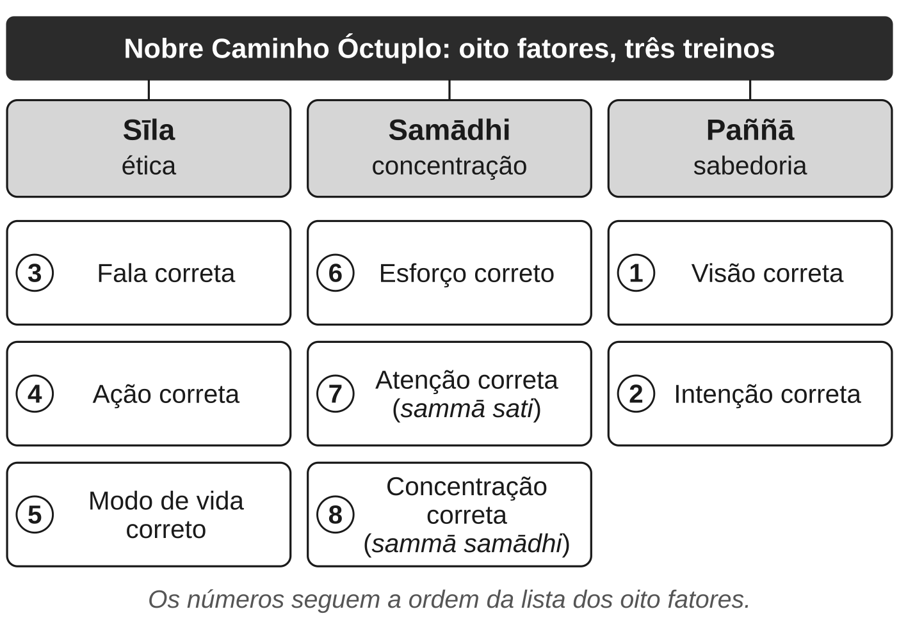

Este capítulo responde à pergunta "meditar é ser budista?" mostrando onde a
meditação fica no mapa da própria tradição. A resposta, em resumo:

- Nos textos, a meditação é uma parte de um treino maior, que tem três
  partes: ética, concentração e sabedoria.
- A palavra mais associada a ela hoje, *mindfulness*, traduz um termo páli
  de sentido mais largo e mais carregado de valores do que a versão moderna.
- O mindfulness clínico é uma adaptação assumida. E o discurso budista mais
  citado como "manifesto do método científico" diz outra coisa.

## O caminho em oito partes

A quarta das Quatro Nobres Verdades, vista no capítulo
{{cap:as-quatro-nobres-verdades-como-diagnostico}}, é um caminho. O **Nobre
Caminho Óctuplo** é a lista dos oito fatores que, segundo os textos, levam ao
fim de dukkha. Um discurso curto, o *Magga-vibhaṅga Sutta* ("a análise do
caminho", *Saṃyutta Nikāya* 45.8), define cada um. Em resumo:

| Fator | O que o texto diz que é |
|---|---|
| Visão correta | conhecer o sofrimento, sua origem, sua cessação e o caminho |
| Intenção correta | a intenção de renúncia, de boa vontade e de não fazer mal |
| Fala correta | abster-se de mentir, de fazer intriga, de falar com aspereza e de tagarelar |
| Ação correta | abster-se de matar, de roubar e da falta de castidade |
| Modo de vida correto | abandonar meios de vida errados e ganhar a vida de modo correto |
| Esforço correto | evitar e abandonar estados mentais nocivos; cultivar e manter os benéficos |
| Atenção correta (*sammā sati*) | observar o corpo, as sensações, a mente e os fenômenos, com empenho e lucidez |
| Concentração correta (*sammā samādhi*) | os quatro estados de absorção meditativa |

"Correto" traduz *sammā*. O termo correspondente em sânscrito também quer
dizer "completo", "inteiro". Por isso há estudiosos que acham "correto" uma
tradução inadequada. A ideia não é obedecer a uma regra, e sim fazer a coisa
por inteiro.

Repare na proporção. Dos oito fatores, só os dois últimos (e, em parte, o
esforço) descrevem o que hoje se chama de meditação. Os outros falam de
como entender o problema, de intenções, de fala, de ação e de trabalho.

## Três treinos: sīla, samādhi, paññā

Um diálogo do cânone, o *Cūḷavedalla Sutta* (*Majjhima Nikāya* 44), agrupa os
oito fatores em três conjuntos. Quem pergunta é um leigo; quem responde é uma
monja, Dhammadinnā. No fim, o Buda diz que teria respondido
exatamente como ela. A divisão dela é esta:

- **Sīla** — ética, conduta. Inclui fala, ação e modo de vida corretos. É o
  treino do que se faz e do que se diz.
- **Samādhi** — concentração, ou, na tradução de Sujato, "imersão". Inclui
  esforço, atenção e concentração corretos. É o treino da mente: estabilidade,
  foco, unificação. Dhammadinnā define samādhi como "unificação da mente".
- **Paññā** — sabedoria, discernimento. Inclui visão e intenção corretas. É
  o treino de ver as coisas como os textos dizem que são: impermanentes,
  insatisfatórias, sem um eu fixo (o capítulo {{cap:impermanencia-e-nao-eu}}).

A mesma divisão em três chegou ao Japão. A filosofia do Zen herda do budismo
indiano a ideia de que o estudo budista tem três componentes: preceitos
éticos, meditação e sabedoria.

Os três não são opções avulsas: os textos os apresentam como partes de um
único caminho. O historiador Robert Sharf (2015) diz o que, de uma perspectiva
budista mais tradicional, falta ao movimento moderno do mindfulness. Falta
justamente essa transformação gradual, que envolve a doutrina e uma forma de
vida budista. Não porque a meditação isolada não funcione para nada. Mas
porque, nesse quadro, ela deixa de ser o mesmo treino.

## Duas direções da meditação: samatha e vipassanā

Dentro do treino da mente, os textos distinguem dois aspectos.

- **Samatha** é calma, serenidade. É o desenvolvimento da estabilidade da
  mente, associado nos textos aos estados de absorção descritos na
  concentração correta.
- **Vipassanā** é visão penetrante, *insight*. É o desenvolvimento da
  compreensão direta da impermanência, da insatisfatoriedade e do não-eu.

O monge e estudioso Bhikkhu Anālayo escreveu o comentário de referência ao
*Satipaṭṭhāna Sutta* (2003), o discurso que este capítulo apresenta adiante. Ele argumenta que, nos suttas, os
dois aspectos são complementares. Uma mente concentrada favorece o *insight*,
e o *insight* facilita concentrações mais profundas. Alguns estudiosos leram
os dois como caminhos separados, com metas diferentes; Anālayo considera essa
leitura equivocada.

Essa distinção ajuda a entender uma novidade do século XX, que o capítulo
retoma adiante. Algumas escolas afirmaram que se pode chegar ao *insight* sem
passar pelas absorções da calma.

## Sati: a palavra que virou "mindfulness"

O sétimo fator do caminho é *sammā sati*. Aqui está a palavra que, traduzida
para o inglês, deu nome a um movimento global.

**Sati** é um termo páli aparentado ao verbo "lembrar"; o equivalente
sânscrito também quer dizer memória. Nos suttas, *sati* aparece às vezes no
sentido literal de recordar. Uma definição canônica, citada por Sharf,
descreve quem tem sati como alguém que "se lembra, que recorda o que foi
feito e dito muito tempo atrás".

Anālayo faz uma leitura cuidadosa dessa definição. Para ele, sati não é
exatamente a memória. É a qualidade que permite que a memória funcione bem:
uma presença da mente que mantém algo à vista. No contexto da meditação, isso
vira atenção ao que está acontecendo agora, *sem perder de vista* o que
importa.

**Mindfulness** é a palavra inglesa usada para traduzir *sati*; em
português, costuma virar "atenção plena". Hoje ela designa também um
conjunto de práticas e programas laicos. A definição mais conhecida é a do
pesquisador Jon Kabat-Zinn. Ele criou o programa de redução de estresse que o
capítulo {{cap:o-que-a-ciencia-da-meditacao-mostra-e-o-que}} discute:

> a consciência que surge ao prestar atenção, de propósito, no momento
> presente e sem julgamento, ao desdobrar da experiência momento a momento.

As duas coisas, sati nos suttas e mindfulness na definição de Kabat-Zinn, se
sobrepõem, mas não são iguais. A diferença está na expressão "sem
julgamento".

## O que é satipaṭṭhāna

O discurso central sobre sati é o *Satipaṭṭhāna Sutta* (*Majjhima Nikāya*
10). **Satipaṭṭhāna** junta *sati* e *upaṭṭhāna*, "estar presente",
"assistir". Anālayo propõe traduzir por "presença da atenção" ou "atender
com atenção". Comentários tardios leem o termo como "fundamento da atenção",
mas, para Anālayo, essa origem da palavra é improvável. Em português, o termo
costuma aparecer como "fundamentos" ou "bases" da atenção.

O sutta abre afirmando que os quatro *satipaṭṭhānas* são "o caminho
direto" (ou "caminho de convergência", na tradução de Sujato) para quatro
fins:

- a purificação dos seres;
- superar a tristeza e o lamento;
- pôr fim à dor e ao desgosto;
- realizar o nirvana.

Os quatro campos de observação são o corpo, as sensações, a mente e os
fenômenos (*dhammas*). O capítulo {{cap:observar-sem-agarrar}} trata deles
como prática.

Três detalhes do texto ajudam a ver a distância entre ele e o mindfulness
moderno:

1. **A observação do corpo não é só a respiração.** O sutta descreve seis
   exercícios para o corpo: a respiração, as posturas, a atenção ao que se
   faz, as partes do corpo, os elementos e o cadáver.
   - Nas partes, o praticante percorre o próprio corpo, dos pés à cabeça,
     nomeando 31 delas: cabelo, ossos, rins, fezes, pus, sangue, entre
     outras. O texto compara esse exame a abrir um saco de grãos e
     reconhecer cada grão.
   - No cadáver, ele compara o próprio corpo a um morto deixado ao ar livre,
     nos estágios da decomposição: "este corpo também é da mesma natureza,
     do mesmo tipo, e não pode ir além disso".

   O texto não fala em relaxar. O refrão diz que o praticante permanece
   "independente, sem se agarrar a nada no mundo". Anālayo lê a meta como
   uma atitude equilibrada e desapegada em relação ao corpo, que enfraquece
   o desejo e lembra a morte. Para ele, a imagem dos grãos pede
   neutralidade, não nojo. Ele lembra também que os próprios textos
   registram o risco. Monges que levaram o exercício ao excesso, tomados de
   repulsa pelo próprio corpo, chegaram ao suicídio.
2. **A observação dos fenômenos é doutrinal.** O praticante observa, entre
   outras coisas, os cinco agregados, as Quatro Nobres Verdades e os cinco
   obstáculos (desejo sensorial, má vontade, torpor e sonolência, agitação e
   remorso, dúvida). Para isso precisa conhecer as categorias do ensinamento.
3. **O objetivo é o despertar.** O sutta termina com uma promessa.
   Quem desenvolver os quatro satipaṭṭhānas por sete anos (e, descendo, até
   por sete dias) pode esperar o despertar nesta vida ou o estado de "não
   retorno". É uma afirmação do texto sobre a libertação, não sobre estresse.

## "Atenção nua": de onde veio o mindfulness moderno

Se o sati dos suttas é carregado de doutrina e de valores, de onde veio a
ideia de uma atenção neutra e sem julgamento? Sharf (2015) conta a história.

No século XX, em Mianmar, mestres de uma linhagem de reforma desenvolveram
técnicas de meditação de *insight* pensadas também para leigos. O mais
influente foi Mahāsi Sayadaw (1904–1982). Ele ensinava a acompanhar, momento
a momento, qualquer objeto que surgisse na experiência. E afirmava algo
radical para a época: o *insight* libertador não exigia antes dominar a
concentração (*samatha*) nem as absorções.

O método não exigia conhecer a filosofia budista nem renunciar à vida leiga.
Podia ser ensinado em retiros relativamente curtos. Isso o tornou fácil de
exportar. Um aluno de Mahāsi, o monge alemão Nyanaponika Thera (1901–1994),
cunhou para essa faculdade a expressão *bare attention*, "atenção nua", num
livro popular de 1954.

Sharf aponta o problema: há pouca coisa "nua" no sati dos textos e dos
comentários antigos. Citando outro estudioso dos textos, ele observa
que sati envolve discernir o valor moral do que aparece: saber se um estado é
benéfico ou nocivo. O "sem julgamento" da definição moderna é, nesse ponto,
o contrário do que o texto pede.

Por isso, para este livro, a tese de que *mindfulness* é uma boa tradução de
*sati* é **contestada**. É uma tradução possível, mas carrega uma
interpretação moderna específica.

Sharf também observa que inovações parecidas já tinham aparecido antes: no
Zen chinês medieval e no Dzogchen, uma tradição tibetana de meditação. Também
ali se prometiam resultados rápidos e a prática se abria a leigos sem
formação doutrinal. Em todos os casos, setores tradicionais as receberam com
desconfiança. O
mindfulness moderno não é uma traição sem precedentes. É mais um capítulo de
uma discussão antiga dentro do próprio budismo.

## O mindfulness clínico é uma adaptação, e diz isso

Kabat-Zinn não esconde o que fez. No mesmo artigo de 2003 em que dá a
definição, ele escreve que o programa "precisava estar livre dos fatores
culturais, religiosos e ideológicos associados às origens budistas do
mindfulness". O objetivo não era ensinar budismo. Era oferecer a pacientes um
ambiente para lidar com estresse, dor e doença. Ele também afirma que a
atenção, sendo uma capacidade humana, é universal: "não há nada de
particularmente budista" nela.

As duas frases convivem com uma tensão. Se a atenção é universal, a forma
específica de treiná-la vem de uma tradição. E o que se tira junto com os
"fatores culturais e religiosos" inclui a ética, a doutrina e o objetivo do
caminho. Isso não invalida os programas clínicos: o que eles fazem ou não
fazem é questão de evidência, tratada na Parte II. Significa que **o
mindfulness clínico é uma prática retirada da tradição e redesenhada para
outro fim**, e deve ser chamado assim.

## O Kālāma Sutta não é o método científico

Um discurso é citado com frequência como prova de que o Buda pregava o
ceticismo científico: o *Kālāma Sutta* (*Aṅguttara Nikāya* 3.65). Os
moradores de uma cidade estão confusos. Muitos mestres passam por lá, cada um
exaltando a própria doutrina e desprezando a dos outros. Eles perguntam em
quem acreditar. O Buda
responde:

> Não se guiem pela tradição oral, pela linhagem, pelo testemunho, pela
> autoridade das escrituras, pela lógica, pela inferência, pelo raciocínio
> plausível, pela aceitação de uma opinião depois de ponderá-la, pela
> aparência de competência, nem pelo pensamento "este asceta é nosso mestre".
> Mas quando vocês souberem por si mesmos: "estas coisas são nocivas,
> censuráveis, criticadas pelas pessoas sensatas, e quando praticadas levam
> ao mal e ao sofrimento", então abandonem-nas.

Lido com atenção, o texto não diz o que o slogan diz, por três razões:

1. **Ele recusa também a lógica e a inferência**, que são ferramentas
   centrais da ciência. O critério não é "teste a hipótese"; é o
   conhecimento direto do efeito de certas condutas.
2. **O assunto é ética, não o mundo físico.** As "coisas" a examinar são a
   cobiça, o ódio e a ilusão, e o que elas levam a fazer: matar, roubar,
   mentir. O sutta continua com o cultivo da boa vontade e da compaixão. E
   termina com quatro "consolos" sobre o que acontece "se houver outro
   mundo" depois da morte.
3. **O juízo individual não basta.** O critério inclui o que é "criticado
   pelas pessoas sensatas". Thanissaro Bhikkhu, tradutor do texto, observa
   em sua nota que ele não é uma carta branca para seguir o próprio senso de
   certo e errado. As conclusões devem ser testadas na prática *e*
   conferidas com a experiência de pessoas sábias.

A leitura "científica" tem uma história. Rahula, em *What the Buddha Taught*,
chama o conselho aos Kālāmas de "único na história das religiões". Sua
paráfrase passa da lista do que não seguir direto a "quando souberem por si
mesmos que certas coisas são nocivas, erradas e más". A cláusula sobre as
pessoas sensatas some. Não é falsificação. É o tipo de seleção que o capítulo
{{cap:quem-foi-o-buda-e-quem-ele-nao-foi}} chamou de modernismo budista.

## Então, meditar é ser budista?

Não. Meditar é usar uma ferramenta que a tradição budista desenvolveu com
grande sofisticação. Como lembra o próprio Kabat-Zinn, ela tem paralelos em
outras tradições. Mas, dentro do budismo, a meditação é uma parte de um
treino. Esse treino inclui conduta ética, compreensão da doutrina e, para
muitos, vida monástica e devoção. E tem uma meta, o despertar, que não é a
redução do estresse.

Na Parte III, este livro vai tratar a meditação principalmente como treino
de atenção e da relação com a própria experiência. Em cada capítulo, vai
dizer o que se perde e o que se ganha com esse recorte. A pergunta "isso
funciona?" é legítima. Só não é a mesma pergunta que a tradição faz.

## O que fica estabelecido

- O **Nobre Caminho Óctuplo** tem oito fatores; só dois ou três descrevem
  meditação.
- Os fatores se agrupam em três treinos: **sīla** (ética), **samādhi**
  (concentração) e **paññā** (sabedoria). Nos textos, eles se sustentam
  mutuamente.
- **Samatha** (calma) e **vipassanā** (*insight*) são dois aspectos
  complementares do treino da mente.
- **Sati** vem de "lembrar" e envolve manter à vista o que importa, inclusive
  o valor moral do que aparece. **Mindfulness** é sua tradução inglesa. A
  leitura moderna como "atenção nua" e "sem julgamento" vem de reformas
  birmanesas do século XX. Que seja uma boa tradução é **contestado**.
- **Satipaṭṭhāna**, "presença da atenção", é a prática descrita no MN 10:
  corpo, sensações, mente e fenômenos, com meta de libertação.
- O mindfulness clínico é uma **adaptação** declarada, retirada da tradição.
- O **Kālāma Sutta** trata de ética, recusa também a lógica e inclui o juízo
  dos sábios. Não é um manifesto do empirismo moderno.

---

*As passagens do* Magga-vibhaṅga Sutta*, do* Cūḷavedalla Sutta*, do*
Satipaṭṭhāna Sutta *e do* Kālāma Sutta *foram traduzidas para o português
por Íris Gradim a partir da versão inglesa de Bhikkhu Sujato, em domínio
público. As citações de Jon Kabat-Zinn (2003), Robert Sharf (2015) e Walpola
Rahula (2.ª ed., 1974) foram traduzidas do inglês por Íris Gradim.*
