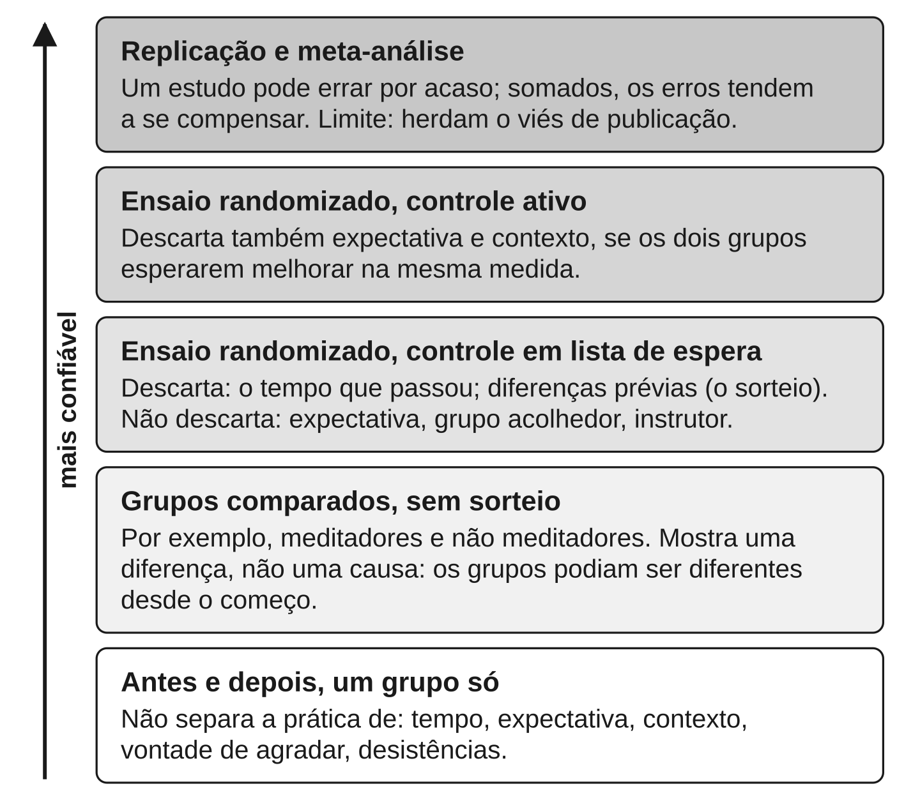

Este capítulo dá as ferramentas para ler o resto do livro, e qualquer
manchete sobre meditação. Para saber se uma prática funciona, é preciso:

1. comparar quem pratica com quem faz outra coisa parecida;
2. decidir por sorteio quem fica em cada grupo;
3. somar muitos estudos em vez de confiar em um.

Quase todo exagero sobre meditação, e sobre o cérebro em geral, vem de pular
uma dessas etapas. O capítulo também define as palavras que o livro usa para
o tamanho de um efeito: pequeno, moderado, grande.

## Melhorar não prova nada

Comece pelo caso mais comum. Trinta pessoas estressadas fazem um curso de
meditação de oito semanas. No fim, estão, em média, menos estressadas do que
no começo. A meditação funcionou?

Talvez. Mas há pelo menos cinco outras explicações, todas plausíveis:

1. **O tempo passou.** Quem procura um curso de estresse costuma fazê-lo num
   momento ruim. Momentos ruins tendem a passar sozinhos.
2. **A expectativa.** Quem se inscreve acredita que vai melhorar. Essa crença
   muda o que a pessoa sente e o que ela responde.
3. **O contexto.** Oito semanas de grupo acolhedor, instrutor atento e tempo
   reservado para si fariam bem com quase qualquer conteúdo.
4. **A vontade de agradar.** Ao fim de um curso de que gostou, a pessoa tende
   a marcar respostas melhores no questionário.
5. **Quem desistiu.** Se quem não se deu bem largou o curso no meio, a média
   de quem ficou parece melhor do que o curso foi.

Nenhuma dessas explicações diz que a meditação *não* funciona. Dizem só que
"as pessoas melhoraram" é compatível com a meditação não ter feito nada. As
ferramentas a seguir separam o efeito da prática de todo o resto.

## Comparar e sortear: o ensaio randomizado

A primeira ferramenta é um **grupo controle**: pessoas parecidas que *não*
recebem a prática testada e são medidas nos mesmos momentos. É como testar um
adubo plantando dois canteiros no mesmo dia, um com adubo e outro sem. Se os
dois crescem igual, o adubo não fez diferença. Só a diferença *entre* os
grupos conta.

A segunda ferramenta é decidir **por sorteio** quem vai para cada grupo.
Parece detalhe, e é o mais importante. Se as pessoas escolhessem, os mais
motivados ou com mais tempo livre tenderiam a escolher a meditação. Qualquer
diferença no fim poderia vir disso. O sorteio espalha essas diferenças, as
conhecidas e as desconhecidas, por igual entre os grupos.

Um estudo que faz as duas coisas é um **ensaio randomizado** (do inglês
*randomized*, "sorteado"; também se diz ensaio clínico randomizado, ou ECR).
É o desenho mais confiável para responder "isto causa aquilo?".

Muitos estudos famosos sobre meditação não são ensaios randomizados. Comparam
meditadores experientes com não meditadores, num único momento. O que eles
encontram é uma **correlação**: duas coisas que andam juntas. Correlação não é
causa. Quem passa anos meditando pode ter sido diferente desde o começo, assim
como quem frequenta academia pode já ser mais saudável antes da primeira aula.
O capítulo {{cap:neuroplasticidade-sem-exagero}} mostra o peso disso nos
estudos sobre o cérebro.

## Comparar com o quê: lista de espera, controle ativo e placebo

Ter um grupo controle não basta. Importa *o que* esse grupo faz. E o controle
mais comum na pesquisa sobre meditação é também o mais fraco.

Esse controle é a **lista de espera**: o grupo não faz nada durante o estudo
e recebe o curso depois. É como comparar um remédio com "volte daqui a dois
meses". Não elimina a expectativa nem o contexto. Pior: infla o resultado,
porque quem espera tende a melhorar *menos* do que melhoraria sendo atendido
normalmente. Uma comparação de mais de 300 ensaios de psicoterapia para
depressão, de 2024, mostrou isso: contra lista de espera, o efeito parecia
cerca de 50% maior do que contra o atendimento de costume. O estudo é sobre
psicoterapia, mas o desenho é o mesmo. Força da evidência: forte.

A saída é um **controle ativo**: o outro grupo faz uma atividade com a mesma
duração, o mesmo formato e o mesmo calor humano, mas sem o ingrediente
testado. É como descobrir se é o tempero que faz o prato bom: o outro grupo
come o mesmo prato, sem o tempero. Se a meditação vence um controle ativo, há
motivo para achar que a meditação em si faz diferença.

Por trás disso está o **placebo**. Na medicina, placebo é um tratamento sem
princípio ativo, como um comprimido de açúcar, que produz melhora real porque
a pessoa espera melhorar. Por extensão, o nome cobre toda a parte do benefício
que vem da expectativa e do contexto, e não do ingrediente testado. Em
remédio, basta um comprimido idêntico. Em meditação é mais difícil: todo
mundo sabe se está meditando.

Quando se usa um controle ativo bem construído, parte da vantagem da
meditação some. Um ensaio de 2012, com 63 pessoas, comparou o MBSR com um
programa de saúde em grupo: atividade física, postura, música e nutrição. (O
MBSR é um curso de meditação em grupo de oito semanas, apresentado no
capítulo {{cap:o-que-a-ciencia-da-meditacao-mostra-e-o-que}}.) Nos
questionários de sofrimento e ansiedade, os dois grupos melhoraram, e o MBSR
não foi mais eficaz que esse controle rigoroso. Num teste de dor por calor, o
MBSR se saiu melhor, mas só quando os participantes usavam a estratégia de
mindfulness. Leitura correta: parte do que se atribui à meditação vem do
pacote (grupo, instrutor, tempo para si). Força da evidência: preliminar, por
ser um estudo só e pequeno.

Controles ativos ainda são minoria. A revisão crítica *Mind the Hype* (2018),
escrita por quinze pesquisadores, vários deles da própria área, cita uma
estimativa: menos de 1 em cada 10 estudos de mindfulness tinha comparado a
prática com um controle ativo. Uma contagem direta de 2021, em
ensaios fora de contextos clínicos, achou um controle passivo em cerca de 7 de
cada 10. Mindfulness, a "atenção plena", é definida no capítulo
{{cap:o-caminho-e-onde-a-meditacao-entra-nele}}.

## Meditação de mentira: o teste do placebo

O veredito vem primeiro: **quanto do benefício da meditação é expectativa
ainda não se sabe**. Quase nenhum ensaio mede a expectativa, e os testes com
meditação simulada são poucos e pequenos. O que existe sugere que há algo
além do placebo, ao menos na dor de laboratório. Força da evidência:
preliminar.

O problema é que nem o controle ativo resolve tudo. Ele só neutraliza o
placebo se os dois grupos *esperarem* melhorar na mesma medida. Se um grupo
acha que recebeu o tratamento "de verdade" e o outro, o prêmio de consolação,
a expectativa continua desigual (Boot et al., 2013). Isso ainda é pouco
medido: uma revisão de 2024 sobre mindfulness e dor achou menos de 1 em cada
10 estudos tratando de expectativa ou placebo.

A resposta mais direta é a **meditação simulada**: um controle apresentado
como meditação, que gera a mesma expectativa, mas sem a instrução que se quer
testar. Funciona como o comprimido de açúcar da meditação. Se a meditação de
verdade supera a simulada, o efeito não é só expectativa.

::: {.relatorio}
**O estudo.** Fadel Zeidan e colegas (2015) sortearam 75 voluntários
saudáveis para quatro dias de meditação mindfulness, creme placebo,
meditação simulada ou ouvir um livro. Depois mediram a dor provocada por
calor. Uma reanálise de 2025, juntando dois ensaios do mesmo laboratório e
115 participantes, repetiu a comparação (Riegner et al., 2025).

**O que encontrou.** O placebo e a meditação simulada também aliviaram a
dor. A meditação de verdade aliviou mais que os dois, nos dois trabalhos.

**Força da evidência:** preliminar. Dor de laboratório, pessoas saudáveis,
grupos pequenos, um laboratório só. Mostra que o efeito sobre a dor aguda
não é *só* placebo. Não diz quanto é expectativa em pacientes.
:::

Fora do laboratório, a conta fica mais difícil. Um ensaio de 2025 sorteou 164
adultos com artrose de joelho para quatro grupos: Reiki (imposição de mãos),
Reiki simulado, mindfulness ou lista de espera. Mindfulness superou o Reiki
simulado. Mas o Reiki empatou com mindfulness: mais da metade das pessoas
melhorou de forma relevante nos dois grupos. É um ensaio só, e o autor sênior
tem ganhos ligados a um programa de mindfulness. Leitura correta: parte do
benefício pode vir do que as duas terapias têm em comum. Força da evidência:
preliminar. Meditação não substitui tratamento; a dor crônica é tratada no
capítulo {{cap:o-corpo-o-sono-e-a-dor}}.

Outro ensaio, com idosos ansiosos ou deprimidos, mediu a expectativa e não a
viu explicar o efeito do MBSR. Também é um ensaio só, e não fecha a questão.

## Um estudo não basta: replicação

O veredito: **cerca de metade dos resultados positivos publicados nas
ciências do comportamento se repete, e com efeito menor.** Força da evidência:
forte. É por isso que este livro põe um rótulo de força em cada achado.

**Replicação** é outro grupo repetir o estudo, de preferência com mais
gente, para ver se o resultado se mantém. É como uma receita: se só
dá certo na cozinha de quem a inventou, talvez o segredo não seja a receita.
Um achado que apareceu uma vez é uma pista, não um fato.

Um resultado é
**estatisticamente significativo** quando seria improvável se não houvesse
efeito nenhum, como uma moeda que dá cara muitas vezes seguidas. Não quer
dizer que o efeito seja grande nem importante. Quer dizer só que dificilmente
é puro acaso.

::: {.relatorio}
**O estudo.** Em 2015, a Open Science Collaboration, no teste mais famoso,
repetiu 100 estudos de psicologia. Em 2026, o projeto SCORE repetiu 274
resultados positivos de 164 artigos de ciências sociais e do comportamento.
As repetições tinham amostras grandes e plano revisado antes (Tyner et al.,
2026).

**O que encontrou.** Em 2015, 97% dos originais e 36% das repetições tinham
resultado estatisticamente significativo. No SCORE, o resultado se repetiu em
55,1% dos casos (49,3% contando por artigo). O efeito típico caiu de 0,25 para
0,10, numa escala de correlação em que 0 é nenhuma relação.

**Força da evidência:** forte. Parte da queda é esperada, lembram os autores
do SCORE: só se repetiram resultados positivos, e esses incluem os que
tiveram sorte.
:::

A meditação tem seu caso exemplar. As mudanças na estrutura do cérebro após
oito semanas de MBSR, muito citadas, não apareceram no maior ensaio
randomizado com controle ativo. O capítulo {{cap:neuroplasticidade-sem-exagero}}
conta a história.

Por que tantos resultados encolhem? Uma razão central é que muitos estudos
têm pouca gente. Em neurociência, o **poder estatístico** médio é muito baixo,
isto é, a chance de detectar um efeito que existe (Button et al., 2013).
Um estudo pequeno funciona como uma rede de malha larga. Deixa passar
os peixes pequenos, e os que pega são justamente os maiores. Por isso, estudo
pequeno com resultado espetacular é o tipo que costuma não se repetir.

## Somar estudos: a meta-análise e o tamanho de efeito

Se um estudo não basta, juntam-se todos. Uma **meta-análise** é um estudo de
estudos. O pesquisador reúne as pesquisas sobre uma pergunta, segundo regras
definidas antes, e combina os resultados num número só. É como ler cem
avaliações de um restaurante em vez de uma. Uma boa meta-análise pesa mais do
que qualquer estudo isolado, porque os erros de cada um tendem a se compensar.

O número que a meta-análise combina é o **tamanho de efeito**: quão grande é a
diferença entre os grupos, e não só se ela existe. O mais comum se chama *d*
(uma variante, *g*, se lê do mesmo jeito). Ele compara a diferença entre os
grupos com o quanto as pessoas já variam naturalmente. Dois centímetros de
diferença de altura entre dois grupos de adultos é pouco, porque adultos
variam muito.

Uma forma intuitiva de ler o *d*: sorteie uma pessoa do grupo que praticou e
uma do grupo controle, e pergunte qual está melhor. Se a prática não fizer
diferença (*d* = 0), a de meditação ganha em 50 de cada 100 sorteios, como
numa moeda. Quanto maior o *d*, mais vezes ela ganha.

**Como este livro traduz o tamanho de efeito em palavras.** No texto, o
livro troca os números de *d* e *g* por palavras, com esta régua:

| Tamanho de efeito (*d* ou *g*) | O livro diz | Em 100 sorteios, quem praticou ganha em cerca de |
|---|---|---|
| não se distingue de 0 | nenhum efeito detectável | 50 |
| cerca de 0,2 | pequeno | 56 |
| cerca de 0,5 | moderado | 64 |
| 0,8 ou mais | grande | 71 ou mais |

Um valor entre duas faixas leva as duas palavras: 0,35 é "pequeno a
moderado". Abaixo de 0,2, ainda é pequeno, e muito pequeno perto de 0,1. A
última coluna é uma conversão feita para este livro, não um dado dos estudos.
Correlações usam outra escala, explicada onde aparecem.

A régua é uma convenção, como as faixas de um termômetro de febre. Três
ressalvas valem sempre:

- **"Nenhum efeito detectável" não prova que o efeito é zero.** Pode haver um
  efeito pequeno que o estudo não teve tamanho para ver.
- **Pequeno não quer dizer inútil.** Um efeito pequeno pode valer a pena se a
  prática é barata e segura. E um efeito grande num estudo pequeno pode
  encolher na replicação.
- **Significativo não quer dizer grande.** Um efeito pode ser real e pequeno:
  a moeda está levemente viciada, mas não cai sempre do mesmo lado.

::: {.relatorio}
**O estudo.** Simon Goldberg e colegas (2018) reuniram ensaios de
intervenções baseadas em mindfulness para pessoas com transtornos
psiquiátricos: 142 amostras e 12.005 participantes. A novidade foi separar
os estudos pelo tipo de grupo controle.

**O que encontrou.** Logo após o tratamento, o tamanho de efeito caiu à
medida que o controle ficava mais exigente:

| Comparado com | *d* | Em palavras | Em 100 sorteios, mindfulness ganha em cerca de |
|---|---|---|---|
| Nenhum tratamento | 0,55 | moderado | 65 |
| Tratamento mínimo | 0,37 | pequeno a moderado | 60 |
| Controle ativo inespecífico | 0,35 | pequeno a moderado | 60 |
| Controle ativo específico | 0,23 | pequeno | 56 |
| Tratamento com eficácia comprovada | −0,004 | nenhuma diferença | 50 |

As duas últimas colunas são leituras feitas para este livro. Os resultados
mais consistentes foram para depressão, dor, tabagismo e dependências. Uma
revisão de 2022, do mesmo grupo, reuniu 44 meta-análises (336 ensaios, 30.483
participantes) e achou o mesmo padrão (Goldberg et al., 2022).

**Força da evidência:** moderada. São sínteses grandes, mas herdam as
fraquezas dos estudos que reúnem, e um dos autores dirige um centro de
pesquisa em meditação.
:::

A tabela resume o capítulo inteiro. Contra "nada", mindfulness tem efeito
moderado. Contra algo parecido, encolhe até ficar pequeno. Contra um tratamento
que já funciona, empata.

Empatar com um tratamento eficaz é um resultado real e útil. Significa que
mindfulness pode ser uma alternativa para algumas pessoas, numa escolha feita
com quem acompanha o tratamento. Mas é muito diferente da manchete "meditação
é melhor que terapia". Meditação não substitui tratamento.

## O que não chega a ser publicado: viés de publicação

O veredito: **em mindfulness, o viés de publicação existe, mas provavelmente
não apaga o efeito.** A taxa de sucesso publicada é alta demais para ser
verdadeira. Força da evidência: moderada.

**Viés de publicação** é a tendência de publicar mais os estudos que deram
certo. Revistas preferem novidades, e pesquisadores largam na gaveta o estudo
que "não deu em nada". É como julgar um curso pelos depoimentos no site:
só aparecem os satisfeitos. A literatura publicada parece mais otimista do que
a realidade, e uma meta-análise feita sobre ela herda o otimismo.

Em mindfulness, o sinal aparece de dois jeitos. Quase 9 em cada 10 ensaios
publicados relatavam algum resultado positivo, bem mais do que o esperado
mesmo se mindfulness fosse tão eficaz quanto a psicoterapia para depressão. E,
dos ensaios registrados, mais da metade seguia inédita dois anos e meio depois
do fim (Coronado-Montoya et al., 2016).

Na outra ponta, a revisão de 2022 de Goldberg e colegas, feita por
pesquisadores de dentro do campo, viu os efeitos resistirem, em geral, aos testes de viés de publicação. Mas achou outros
vieses importantes.

Um viés parecido vem de quem faz a pesquisa. Goldberg e Tucker (2020)
reanalisaram 60 comparações entre mindfulness e outros tratamentos
reconhecidos. Mindfulness levava uma vantagem pequena no conjunto. Essa
vantagem aparecia quando os pesquisadores simpatizavam com mindfulness, e
sumia quando a simpatia estava ausente ou equilibrada. É uma associação entre
estudos, não um experimento. E ninguém precisa trapacear para isso acontecer:
quem acredita num tratamento tende a aplicá-lo melhor e a ler o ambíguo a seu
favor. Força da evidência: moderada.

A principal defesa é o **pré-registro**: publicar o plano do estudo antes de
colher os dados. Quantas pessoas, que controle, qual o desfecho principal,
como será a análise. É como lacrar o palpite num envelope antes do jogo:
depois, não dá para trocar de aposta nem sumir com o envelope.

Um bom exemplo é um ensaio pré-registrado de 2024, com mais de 2 mil pessoas
em dezenas de locais. Um único exercício de mindfulness de 15 minutos reduziu
o estresse relatado logo em seguida, mais do que ouvir um trecho de ficção em
áudio. Os autores apontam os limites: efeito pequeno, uma sessão só, quase
todos estudantes. Força da evidência: moderada, para alívio imediato do
estresse relatado, e nada além disso.

## Imagens do cérebro: o que a fMRI mede

O veredito: **imagens do cérebro são úteis, mas frágeis.** Dependem de
escolhas de análise, variam na mesma pessoa e, para comparar pessoas,
precisam de muita gente. Força da evidência: forte.

As manchetes com manchas coloridas no cérebro vêm quase sempre de **fMRI**,
a ressonância magnética funcional. É o aparelho de ressonância dos hospitais,
programado para registrar mudanças na oxigenação do sangue em cada
pequeno ponto do cérebro. Quando uma região trabalha mais, o fluxo de sangue
oxigenado para ela muda (Raichle et al., 2001). É como saber que cômodos de
uma casa estão em uso olhando o consumo de luz de cada um: a fMRI não vê as
células trabalhando, vê um sinal que acompanha a atividade delas.

Esse sinal é fraco e cheio de ruído. Um exame típico divide o cérebro em
cerca de 130 mil pequenos cubos e faz um teste estatístico em cada um. Com
tantos testes, alguns darão "positivo" por puro acaso, como numa rifa com
milhares de bilhetes: algum sempre sai premiado. A análise precisa corrigir o
cálculo para isso.

Um experimento de 2010 mostrou o problema de um jeito que ninguém esqueceu.
Pesquisadores puseram um salmão morto no aparelho, mostraram a ele fotos de
pessoas em situações sociais e "pediram" que dissesse que emoção cada pessoa
devia estar sentindo. Sem a correção estatística, a análise achou pontos
"ativos" no cérebro do peixe. Com a correção, nenhum (Bennett et al., 2010).
O trabalho ganhou o Prêmio Ig Nobel de neurociência de 2012.

O salmão é uma piada séria, e é preciso lê-lo direito. Ele *não* mostra que a
fMRI não presta. Mostra que uma análise sem correção produz falsos positivos,
e que a correção funciona. Mas corrigir não basta. Três achados mais
recentes pesam mais:

1. **Mesmos dados, conclusões diferentes.** Em 2020, 70 equipes receberam os
   mesmos exames e as mesmas hipóteses. Nenhuma analisou do mesmo jeito que
   outra, e as respostas variaram bastante.
2. **Mesma pessoa, medidas diferentes.** Dois exames da mesma pessoa, na
   mesma tarefa, concordam pouco: em média, cerca de 0,4 numa escala em que 1 é
   repetição perfeita. É pouco demais para comparar uma pessoa com outra.
3. **Comparar cérebros pede milhares.** Uma análise de cerca de 50 mil exames
   mostrou que, com a amostra típica de cerca de 25 pessoas, as relações entre
   o cérebro e traços psicológicos saem exageradas e não se repetem (Marek et
   al., 2022). Estudos que testam uma intervenção precisam de menos gente,
   ressalvam os autores. O alvo é o estudo que compara cérebros de meditadores
   e não meditadores.

A fMRI, bem usada, continua valiosa. A pergunta certa diante de uma imagem
não é "a fMRI é confiável?", mas "esta análise foi planejada antes, feita do
jeito certo, e com quantas pessoas?".

## "A região acendeu, então…": a inferência reversa

Há um erro mais sutil, que aparece mesmo em estudos bem analisados. Ele se
chama **inferência reversa**: deduzir um estado mental a partir da ativação
de uma região do cérebro. "A região da recompensa acendeu, então a meditação
dá prazer."

O exemplo clássico é a **amígdala**, uma pequena região do cérebro ligada à
detecção de ameaça e de relevância emocional. Os estudos mostram que o medo
costuma ativá-la. Isso não quer dizer que toda ativação da amígdala seja
medo. A mesma região participa de muitas outras coisas: novidade, relevância,
surpresa.

O raciocínio vai, portanto, na direção errada. Ele não é logicamente válido,
mas pode dar *alguma* informação: tanto mais quanto mais seletiva for a
região, isto é, quanto menos coisas diferentes a ativarem (Poldrack, 2006).
Para a maior parte das regiões de que as manchetes falam, a seletividade é
baixa.

Uma analogia ajuda. Saber que quem está gripado costuma espirrar não permite
concluir que quem espirra está gripado: poeira, pimenta e alergia também
fazem espirrar. O cérebro tem pouquíssimas regiões que só "espirram" por um
motivo.

O capítulo {{cap:a-mente-que-divaga}} traz um exemplo concreto: uma rede de
regiões que fica menos ativa em meditadores, e a tentação de concluir daí
que eles "pensam menos em si mesmos".

## Seis perguntas para qualquer manchete

O capítulo cabe numa lista. Diante de "estudo comprova que meditação…",
pergunte:

1. **Houve grupo controle, e as pessoas foram sorteadas?** Se não, o estudo
   mostra uma correlação, não uma causa.
2. **O controle fazia o quê?** Nada, lista de espera ou algo ativo e
   parecido? Quanto mais fraco o controle, mais o resultado inclui
   expectativa e contexto.
3. **Quantas pessoas?** Estudos com dezenas de participantes são pistas.
   Resultados grandes em amostras pequenas tendem a encolher.
4. **O plano foi registrado antes, com um desfecho principal?** Se não, não
   dá para saber quantas outras medidas foram tentadas.
5. **Foi repetido, ou somado numa meta-análise?** E o efeito é pequeno,
   moderado ou grande?
6. **Se há imagem do cérebro, o que exatamente foi medido?** Uma região que
   "acende" não revela, sozinha, o que a pessoa sentiu.

Essas perguntas não servem para desconfiar de tudo, e sim para dar o peso
certo a cada coisa. Algumas afirmações sobre meditação passam bem por todas
as seis; muitas não passam pela primeira.

## O que fica estabelecido

- "As pessoas melhoraram" não prova nada, e **correlação** não é causa. Só
  um **ensaio randomizado**, com **grupo controle** sorteado, permite falar
  em causa.
- A **lista de espera** infla o efeito (forte). O **controle ativo** separa
  o ingrediente do **placebo** só se as expectativas forem parecidas.
- Contra **meditação simulada**, mindfulness aliviou mais a dor de
  laboratório (preliminar). Quanto do benefício é expectativa ainda não se
  sabe.
- Cerca de metade dos resultados positivos se repete, com efeitos menores
  (forte). **Estatisticamente significativo** quer dizer "dificilmente é
  acaso", não "grande".
- Neste livro, o **tamanho de efeito** é pequeno (cerca de 0,2), moderado
  (cerca de 0,5) ou grande (0,8 ou mais). Em mindfulness, encolhe de
  moderado para pequeno quando o controle fica mais exigente, e empata com
  tratamentos eficazes (moderada).
- O **viés de publicação** e a simpatia dos pesquisadores inflam a
  literatura; o **pré-registro** é a principal defesa (moderada).
- O salmão morto mostra o perigo de uma análise de **fMRI** sem correção.
  Hoje pesam mais as escolhas de análise, a baixa confiabilidade e as
  amostras pequenas (forte). A **inferência reversa** é fraca, a menos que
  a região seja seletiva.

**A posição deste livro.** Uma afirmação sobre meditação só conta como
estabelecida quando vem de ensaios randomizados, registrados antes, de
tamanho adequado, contra um controle ativo, e repetidos ou somados. Por esse
critério, o retrato honesto é: benefícios reais e pequenos em alguns
desfechos, não um tratamento excepcionalmente poderoso. Ficam em aberto
quanto desse benefício é expectativa e quanto dos achados de imagem cerebral
resistiria a amostras de milhares de pessoas.
