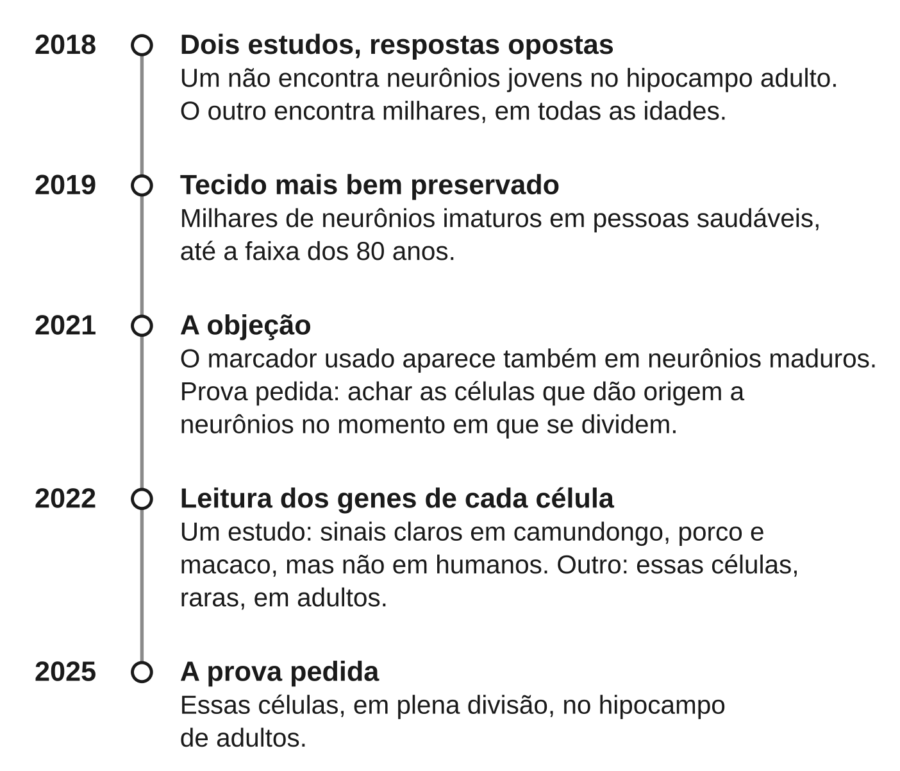

Este capítulo responde a uma pergunta que sustenta o resto do livro: o
cérebro adulto muda com o que fazemos? Sim, e isso está bem demonstrado. Mas
ele muda de um jeito mais modesto, mais lento e mais difícil de medir do que
dizem os livros populares. Ao fim, você deve saber o que é neuroplasticidade,
que tipo de mudança está demonstrado e por que "a meditação religa seu
cérebro em oito semanas" não se sustenta.

## As peças: neurônio e sinapse

O cérebro tem muitos tipos de célula. As que importam aqui são os
**neurônios**: células especializadas em receber e transmitir sinais. Cada
neurônio recebe mensagens de outros. Quando o conjunto passa de certo
limiar, ele dispara um sinal elétrico que segue adiante.

O ponto onde um neurônio passa a mensagem a outro chama-se **sinapse**. Na
maioria delas os dois neurônios não se tocam: o primeiro libera substâncias
químicas num espaço minúsculo, e o segundo as capta. Uma sinapse pode ser
forte (a mensagem passa fácil) ou fraca (passa mal).

Essa força pode mudar, e é isso que interessa. Se a força das sinapses muda,
muda o caminho dos sinais, e com ele o que o cérebro faz. É nessa escala que
acontece a maior parte do aprender.

## O que "neuroplasticidade" quer dizer

**Neuroplasticidade** é a capacidade do sistema nervoso de mudar sua
estrutura e seu funcionamento com o uso, a experiência e o aprendizado. A
palavra cobre escalas muito diferentes: uma única sinapse, conexões novas, o
volume de uma região inteira. Quando alguém diz "neuroplasticidade", vale
perguntar: em que escala?

A ideia central vem do psicólogo canadense Donald Hebb, em 1949: quando um
neurônio ajuda repetidamente a fazer outro disparar, a conexão entre os dois
se fortalece. É a **aprendizagem hebbiana**: conexões usadas juntas se
reforçam. O slogan "neurônios que disparam juntos se conectam" é uma
paráfrase posterior, não a frase de Hebb, mas resume bem a ideia.

Hebb propôs isso como teoria. Depois, experimentos em animais encontraram
nas sinapses mecanismos que funcionam como ele previu. Que as sinapses mudam
com o uso, e que isso está na base da memória e do aprendizado, é um dos
achados mais firmes da neurociência. Força da evidência: forte.

No dia a dia, isso quer dizer: toda vez que você aprende um nome, um caminho
ou uma receita, seu cérebro mudou. Neuroplasticidade não é um poder especial
ativado por técnicas. É o funcionamento normal do cérebro. Por isso "a
meditação causa neuroplasticidade" é verdadeiro e quase vazio: qualquer
coisa que você aprende causa.

## Um mito para tirar do caminho: os 10%

A ideia de que usamos só 10% do cérebro costuma vir junto com promessas de
"despertar seu potencial". Ela é falsa. Força da evidência: forte (consenso
científico).

O cérebro pesa cerca de 3% do corpo, mas gasta cerca de 20% da energia dele.
E a maior parte dele está ativa quase o tempo todo. Não há 90% adormecidos
esperando uma técnica para acordar.

## O que se vê num exame: a massa cinzenta

A mudança nas sinapses é microscópica e invisível em qualquer exame feito
numa pessoa viva. A ressonância magnética mede algo muito mais grosso: o
volume ou a espessura de regiões inteiras.

A medida mais usada é a de **massa cinzenta**: o tecido onde ficam os corpos
dos neurônios e grande parte das sinapses. Quando um estudo diz que "a
meditação aumentou a massa cinzenta", quer dizer que, numa região, o
programa de análise estimou um pouco mais desse tecido.

O problema é a distância entre as duas escalas. Uma revisão crítica de 2013
apontou que as mudanças do treino, em animais, são microscópicas, e que a
ressonância tem resolução baixa demais para vê-las com segurança. Os autores
concluíram que falhas de desenho, de estatística e de método podem explicar
muitos dos efeitos relatados em humanos. A revisão é ela mesma parte de um
debate em aberto, mas dá a medida da cautela necessária.

## Os taxistas de Londres

O exemplo mais famoso de mudança estrutural no cérebro adulto vem dos
taxistas de Londres. Para receber a licença, eles precisam decorar o traçado
de milhares de ruas, num treinamento que leva anos. Força da evidência:
moderada.

A região que interessa é o **hipocampo**: uma estrutura curva, uma de cada
lado do cérebro, na parte interna, atrás das têmporas. Ele é essencial para
formar memórias novas e para se orientar no espaço: lembrar onde as coisas
ficam e como ir de um lugar a outro.

A pesquisa da neurocientista Eleanor Maguire veio em três passos, e cada um
ensina algo:

1. **Em 2000**, ela comparou taxistas com homens que não dirigiam táxi. Nos
   taxistas, a parte de trás do hipocampo era maior, e a da frente, menor.
   Quanto mais anos de profissão, mais forte o padrão. Mas uma foto de um
   único momento não mostra a causa: talvez quem tem um hipocampo assim
   vire taxista com mais facilidade.
2. **Em 2006**, comparou taxistas com motoristas de ônibus, que dirigem há
   tanto tempo quanto eles, com estresse parecido, mas sempre nas mesmas
   rotas. A diferença voltou a aparecer nos taxistas. E veio com um custo:
   eles foram *piores* em aprender informação visual e espacial nova. A
   plasticidade não é só ganho; pode ser redistribuição.
3. **Em 2011**, veio o estudo que faltava: acompanhar as mesmas pessoas ao
   longo do tempo.

::: {.relatorio}
**O estudo.** Katherine Woollett e Eleanor Maguire (2011) examinaram 79
homens no início do treinamento para taxista e 31 homens fora do
treinamento. Repetiram os exames de três a quatro anos depois.

**O que encontrou.** Dos 79 aprendizes, 39 se qualificaram. Só nesses a
massa cinzenta aumentou na parte de trás do hipocampo, junto com mudanças na
memória. Nos 20 que não se qualificaram e voltaram para o segundo exame, e
nos controles, não houve mudança. No início, os grupos não diferiam.

**Força da evidência:** moderada. É o melhor dado humano de que um
aprendizado intensivo muda a estrutura do cérebro adulto. Mas não houve
sorteio (ninguém pode ser sorteado para virar taxista), a amostra é de
dezenas de pessoas, e a escala de tempo é de anos de treino diário, não de
semanas.
:::

## O malabarismo: o que vem nem sempre vai

Treinos mais curtos também mudam a ressonância, mas a mudança pode recuar.
Força da evidência: preliminar.

Num estudo de 2004, adultos que nunca tinham feito malabarismo aprenderam a
manter três bolas no ar. Depois de alguns meses, a ressonância mostrou mais
massa cinzenta em áreas ligadas à percepção visual de movimento. Meses depois de
pararem, o aumento tinha diminuído. O estudo é pequeno e depende de
ressonância, com todos os limites vistos acima.

Isso não quer dizer que "o cérebro devolve o que deixou de usar". Um modelo
teórico de 2017 propõe que o volume cresça no começo de um aprendizado e
depois volte, no todo ou em parte, ao ponto de partida. Nesse meio-tempo, um
processo de seleção conservaria o que serve. Se for assim, volume que recua
não é habilidade perdida, e o volume diz pouco sobre o que se aprendeu.

## Neurônios novos? Uma controvérsia que avançou

Se o adulto humano produz neurônios novos ainda é contestado. A evidência
mais recente pende para o sim, em nível baixo. E nenhum estudo mediu o
efeito da meditação sobre isso.

A produção de neurônios novos chama-se **neurogênese**. Em roedores e
macacos adultos, ela continua numa pequena parte do hipocampo. A pergunta é
se isso acontece no ser humano adulto, e em que quantidade.

Em 2018, dois estudos com tecido de cérebros humanos deram respostas
opostas. Um não encontrou neurônios jovens no hipocampo adulto. O outro
encontrou milhares, em todas as idades. Parte da briga era sobre o método: o
marcador usado para reconhecer neurônios novos aparece também em neurônios
maduros. A prova mais forte, disse um dos grupos, seria flagrar as células
que dão origem a neurônios no momento em que se dividem.

Em 2025, um estudo relatou exatamente isso no hipocampo de adultos. A figura
mostra o caminho até lá.

O que ainda não se sabe é quantos neurônios novos um adulto produz, e se
eles têm função na memória ou no humor. Os métodos ainda dão respostas
diferentes. Força da evidência: contestada. E "a meditação faz nascer
neurônios novos" afirma algo que ninguém mostrou.

## "Religue seu cérebro em oito semanas"

Esta é a promessa que mais circula, e ela é contestada: o teste mais
rigoroso não a confirmou.

A promessa nasceu de estudos pequenos. Eles encontraram mais massa cinzenta
em algumas regiões depois do MBSR, um curso de meditação de oito semanas (o
capítulo {{cap:o-que-a-ciencia-da-meditacao-mostra-e-o-que}} explica o
programa). O mais citado, de Britta Hölzel e colegas (2011), comparou poucas
dezenas de pessoas com um grupo em lista de espera, sem sorteio. É o tipo de
desenho que o capítulo {{cap:como-saber-se-algo-funciona}} mostrou ser
fraco.

Em 2022, o laboratório de Richard Davidson testou a mesma ideia com rigor
muito maior. Foi um ensaio randomizado com mais de duzentas pessoas, controle
ativo e lista de espera. Não apareceu nenhuma mudança estrutural atribuível
ao MBSR, nem nas regiões apontadas antes. Os achados de Hölzel não se
repetiram (detalhes no capítulo
{{cap:o-que-a-ciencia-da-meditacao-mostra-e-o-que}}).

Os próprios autores sugeriram que talvez só um treino muito mais longo, ou
concentrado numa única prática, mude a estrutura. Um ensaio do mesmo ano, o
Age-Well, testou um treino muito mais longo: dezoito meses de meditação em
idosos. O volume não mudou. Mas a meditação superou as aulas de inglês do
grupo de comparação numa medida de atenção, emoção e autoconhecimento.

::: {.relatorio}
**O estudo.** Ensaio Age-Well, na França (Chételat e colegas, 2022). 137
adultos de 65 anos ou mais, sem problemas cognitivos, foram sorteados para
dezoito meses de meditação (n = 45), dezoito meses de aulas de inglês com a
mesma estrutura (n = 46) ou nenhuma intervenção (n = 46). Os dois treinos
tinham sessões semanais de duas horas, prática diária de 20 minutos ou mais
e dias de prática intensiva. Todos, menos um, completaram o estudo. As
medidas principais eram o volume e o fluxo de sangue de duas regiões do
córtex, o cingulado anterior e a ínsula.

**O que encontrou.** Nenhuma diferença na mudança de volume das duas regiões
(p = 0,36 e p = 0,58). As diferenças no fluxo de sangue não chegaram a ser
significativas (p = 0,06 e p = 0,09). Mas a meditação superou as aulas de
inglês numa medida combinada de regulação da atenção, capacidades
socioemocionais e autoconhecimento (*d* = 0,52).

**Força da evidência:** moderada, para a conclusão de que esse programa não
mudou o volume dessas regiões. É um único ensaio, só com idosos, que olhou
só para duas regiões.
:::

O resultado positivo mais forte a pôr ao lado desse ainda é preliminar. Num
estudo de nove meses, o ReSource Project, cada módulo de treino foi seguido
de mudanças diferentes na espessura do córtex. Essas mudanças acompanharam
melhoras em atenção, compaixão e capacidade de se pôr no lugar do outro. Mas
é um estudo só, de um único grupo, que comparou os módulos entre si. Força
da evidência: preliminar.

## A meta-análise que foi retirada

A única meta-análise que dizia que ensaios de mindfulness mudam a estrutura
do cérebro foi retirada pela revista. Ela não deve ser citada como prova.

Publicada em 2023, ela afirmava no título que os ensaios "levaram a mudanças
estruturais no cérebro". Em 2025 a revista retirou o artigo, o que se chama
**retratação**. Segundo a nota, a análise tinha deixado de fora quatro
estudos que não acharam efeito, com 40% dos participantes. Também tinha
incluído estudos com populações muito específicas. Assim, não testava a
pergunta que dizia testar. Os autores discordam da retratação.

É o viés de publicação do capítulo {{cap:como-saber-se-algo-funciona}} na
forma mais direta. E o artigo ainda circula.

## E quem medita há anos?

Quem medita há anos tem, em média, algumas regiões do cérebro diferentes de
quem não medita. Mas isso não prova que a meditação causou a diferença.
Força da evidência para "a meditação retarda o envelhecimento do cérebro":
preliminar.

Uma meta-análise de 2014 reuniu estudos com cerca de 300 praticantes. Achou
diferenças em oito regiões, e um efeito médio de tamanho moderado. Os próprios autores
chamaram o viés de publicação e os limites de método de "preocupações
fortes". E a maioria desses estudos compara, num único momento, quem
medita com quem não medita. Não separam o efeito da prática das diferenças
entre quem escolhe meditar e quem não escolhe.

Daí vem a manchete de que meditadores têm o cérebro "7,5 anos mais jovem".
Um estudo de 2016 usou um programa de computador que estima, por sinais
anatômicos, quantos anos um cérebro aparenta. Comparou 50 meditadores de
longa data com 50 não meditadores. Aos cinquenta anos, o cérebro dos
meditadores parecia 7,5 anos mais jovem.
Três coisas pedem cautela. A amostra é pequena. As pessoas escolheram
meditar, e comparações assim tendem a inflar efeitos (capítulo
{{cap:como-saber-se-algo-funciona}}). E o Age-Well, que sorteou quem
meditaria, não encontrou ganho de volume.

## O veredito

A afirmação de que oito semanas de MBSR mudam a estrutura do cérebro é
contestada, por um motivo concreto. O maior e mais rigoroso ensaio não
encontrou mudança, e a única meta-análise que dizia o contrário foi
retratada. Dezoito meses de meditação em idosos também não mudaram o volume
das regiões estudadas.

Se anos de prática intensiva mudam a estrutura do cérebro, ainda não se
sabe. Nenhum ensaio randomizado testou isso, e os estudos com praticantes
antigos não separam causa de seleção.

Isso não quer dizer que a meditação "não faz nada no cérebro". Se ela muda
atenção ou hábitos, provavelmente muda sinapses, numa escala que a
ressonância não alcança; é uma inferência, não uma medida. Pequenas mudanças
no modo como regiões funcionam juntas foram medidas depois de treinos de
mindfulness (preliminar; capítulo {{cap:a-mente-que-divaga}}). E o que o
MBSR faz pela saúde é outra pergunta, com outra resposta.

## O que isso significa para quem medita

A neuroplasticidade é a razão pela qual faz sentido falar em *treinar* a
mente. Como o cérebro muda com o uso, voltar a atenção para a respiração ou
notar uma reação antes de segui-la tem como deixar rastro.

Mas mudança no cérebro não é o benefício. O que importa é se a pessoa presta
mais atenção, sofre menos, dorme melhor. O Age-Well mostrou benefício sem
mudança de volume. E plasticidade não tem direção moral: a preocupação
repetida também treina o cérebro, como mostra o capítulo
{{cap:a-mente-que-divaga}}.

## O que fica estabelecido

- **Sinapses**, os pontos de contato entre **neurônios**, mudam de força
  com o uso (forte). Essa **neuroplasticidade** é o funcionamento normal do
  cérebro, não um poder da meditação; a **aprendizagem hebbiana** é sua
  ideia central. Não usamos só 10% do cérebro.
- Mudanças de **massa cinzenta** visíveis na ressonância existem, mas são
  pequenas e frágeis de medir (moderada). O melhor exemplo, o **hipocampo**
  dos taxistas de Londres, levou anos.
- Se o adulto humano produz neurônios novos (**neurogênese**) ainda é
  contestado; a evidência de 2022 a 2025 pende para um nível baixo. Não há
  base para dizer que a meditação cria neurônios.
- Mudança estrutural com oito semanas de MBSR: contestada. O maior ensaio
  não a encontrou; dezoito meses de meditação em idosos trouxeram
  benefícios medidos sem mudar o volume das regiões estudadas; a
  meta-análise que dizia o contrário sofreu **retratação**.
- O "cérebro mais jovem" dos meditadores de longa data vem de comparações
  pequenas entre pessoas que escolheram meditar (preliminar).

Em uma frase: meditar é aprender, e aprender muda o cérebro, mas essa
mudança não aparece de forma confiável nos exames de estrutura; os
benefícios se medem no comportamento e na saúde. Em aberto ficam três
perguntas: se anos de prática intensiva mudam a estrutura do cérebro, se as
pequenas mudanças de funcionamento explicam algum benefício, e quanta
neurogênese adulta existe e para que serve.
