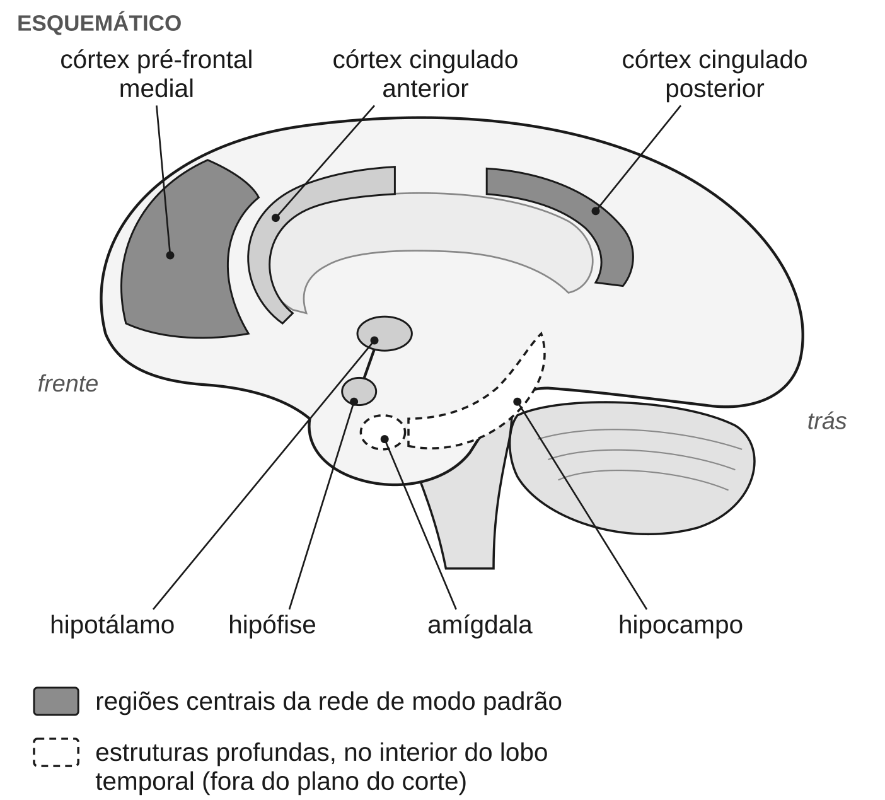
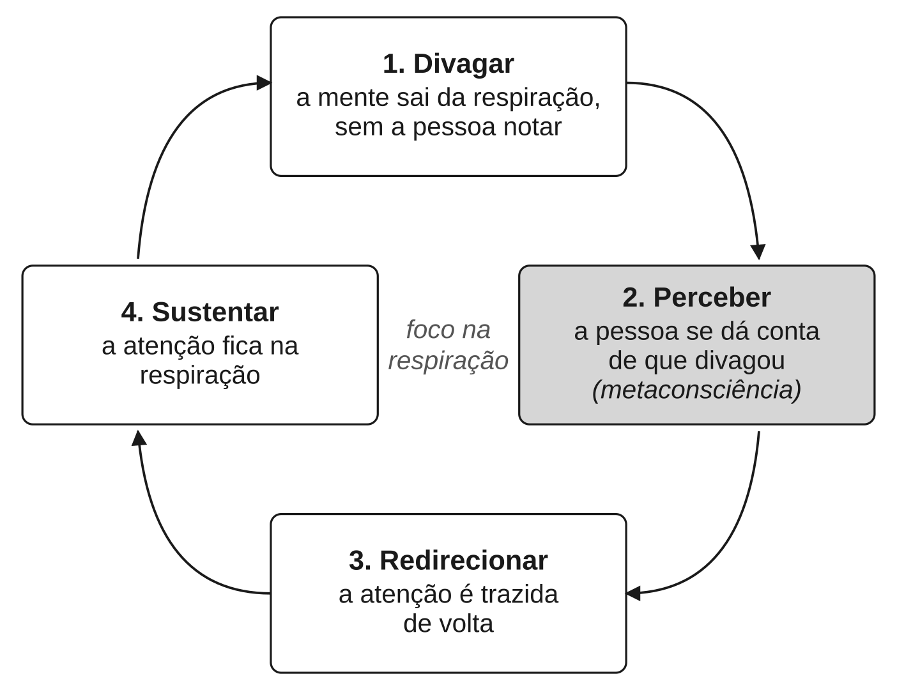

Este capítulo explica por que é tão difícil ficar no presente. A resposta
curta: não ficar no presente é o estado normal da mente. Ela passa algo
entre um terço e metade do tempo pensando em outra coisa. Há redes do
cérebro associadas a esse modo de funcionar, e ele tem custos e benefícios.
Por isso a habilidade que a meditação treina não é parar de divagar. É
*perceber* que divagou.

## O que é divagar

**Divagação mental** é quando a atenção sai do que você está fazendo e vai
para pensamentos e sentimentos sem relação com a tarefa. Você lê uma página
e, no fim, não sabe o que leu, porque estava pensando na conversa de ontem.
Lava a louça e, sem decidir, está planejando a semana.

Uma revisão importante da área descreve três traços desse estado:

- **A mente se desliga dos sentidos.** Os olhos continuam na página, mas a
  informação não entra.
- **O conteúdo vem de dentro**: lembranças, planos, preocupações, emoções.
- **Mantê-la sob controle usa as mesmas capacidades** com que nos
  concentramos de propósito.

Dois detalhes importam. Primeiro, divagar nem sempre é involuntário. Às
vezes deixamos a mente vagar de propósito, e uma revisão de 2016 mostrou que
os dois tipos se comportam de modo diferente. A meditação trabalha com a
divagação sem intenção, a que só se percebe depois. Segundo, divagar não é
necessariamente ruim, como se verá adiante.

## Quanto tempo a mente passa fora

**Veredito: forte.** A mente sai do presente em algo entre um terço e
metade dos momentos acordados. O número exato depende de como se pergunta.

O estudo que tornou isso conhecido usou um aplicativo de celular. Até 2010,
os estudos no dia a dia sobre divagação e felicidade eram raros e pequenos.
O aplicativo permitiu perguntar a milhares de pessoas, em momentos
aleatórios, o que estavam fazendo e pensando naquele instante.

::: {.relatorio}
**O estudo.** Matthew Killingsworth e Daniel Gilbert, 2010. Um aplicativo
de iPhone chamava os participantes em momentos aleatórios do dia e fazia
três perguntas. Como você está se sentindo agora, de 0 a 100? O que está
fazendo? Está pensando em algo diferente do que está fazendo? A análise usou
respostas de 2.250 adultos.

**O que encontrou.**

- A mente divagava em 46,9% das respostas, e em pelo menos 30% delas
  durante quase todas as atividades.
- As pessoas eram menos felizes divagando do que concentradas no que
  faziam.
- Divagar para assuntos agradáveis (42,5% das divagações) não deixava
  ninguém mais feliz do que estar no presente. Divagar para assuntos
  neutros ou desagradáveis deixava menos feliz.
- O que a pessoa pensava previa sua felicidade melhor do que o que ela
  fazia.
- Segundo os autores, a ordem dos acontecimentos sugeria fortemente que a
  divagação vinha antes da infelicidade, e não só depois.

**Força da evidência:** moderada para a frequência da divagação: a amostra
é grande e a medida foi feita no dia a dia. Para "divagar causa
infelicidade", a pesquisa posterior tornou a conclusão contestada (ver
abaixo). Os participantes eram voluntários com iPhone, não uma amostra
representativa, e o estudo é correlacional.
:::

Uma meta-análise de 2023 reuniu 17 estudos do mesmo tipo e chegou a cerca
de um terço do dia. Ela mostrou também que o jeito de perguntar mexe na
resposta: usar o celular da própria pessoa e perguntar com frequência
alteram os relatos.

## Divagar deixa infeliz?

**Veredito.** Que divagar anda junto com estar um pouco menos feliz é
**moderada**. A relação é real, mas pequena, e depende mais de *para onde*
a mente vai do que do fato de ela ir. Que divagar *cause* infelicidade é
**contestada**.

O título do artigo de 2010, "Uma mente que divaga é uma mente infeliz",
virou frase de efeito. A primeira metade se sustenta; a segunda é a mais
frágil. Os autores tentaram separar causa e efeito olhando a ordem dos
acontecimentos ao longo do dia. Isso não é um experimento: ninguém foi
sorteado para divagar mais ou menos.

Sem sorteio, sobram outras explicações. Os próprios autores lembram que já
se sabia que o mau humor faz a mente divagar. E um terceiro fator, como
cansaço, estresse ou um problema não resolvido, pode produzir as duas
coisas. Correlação não é causa, como o capítulo
{{cap:como-saber-se-algo-funciona}} mostrou.

Quem refez esse tipo de análise não encontrou o mesmo. Dois estudos mostram
por quê:

- **A ordem pode ser a inversa.** Um estudo de 2013, também com celulares,
  viu a tristeza vir *antes* da divagação. E a divagação só previa piora do
  humor quando o conteúdo era negativo.
- **O que pesa é o tom do pensamento.** Um estudo de 2025, com mais de 300
  pessoas, perguntou o tom do pensamento também nos momentos de presença. O
  estudo de 2010 não tinha feito isso. A diferença de humor foi explicada em
  grande parte por esse tom.

::: {.relatorio}
**O estudo.** Kam e colegas, revisão sistemática com meta-análise, 2024.
Reuniu 76 estudos sobre divagação e bem-estar emocional em adultos; 64, com
23.168 participantes, entraram nas contas.

**O que encontrou.** Em média, divagar anda junto com bem-estar pior, mas
pouco: uma correlação de −0,18, numa escala em que 0 é nenhuma relação e −1
uma relação negativa perfeita. O tamanho e até o sentido da relação mudavam
conforme o conteúdo do pensamento, a intenção e o método de medida.

**Força da evidência:** moderada para uma associação pequena. Os estudos
são correlacionais e não decidem quem causa quem.
:::

Resolver a questão de vez é difícil. Seria preciso um experimento no dia a
dia, e não há como sortear pessoas para divagar mais durante semanas.

## Divagar também serve para alguma coisa

**Veredito.** O custo em tarefas é **moderada**. O papel no planejamento é
plausível, mas **preliminar**, porque foi pouco testado diretamente. O
benefício para a criatividade é **contestada**.

Primeiro, o custo. Divagar está associado a erros em tarefas que exigem
atenção, de ler a dirigir. E aumenta à medida que a tarefa se prolonga: uma
meta-análise de 2025, com mais de 10 mil pessoas, confirmou isso.

Depois, o uso. A revisão citada no início liga a divagação ao planejamento
do futuro e à criatividade. Uma mente incapaz de sair do presente não
poderia ensaiar uma conversa difícil.

A criatividade é o benefício mais citado e o menos firme. Num estudo, uma
pausa com uma tarefa fácil, que deixa a mente vagar, melhorou a solução de
problemas criativos. Noutra série de três estudos, divagar durante a pausa
não teve relação com o desempenho criativo.

O problema, portanto, não é divagar. É divagar sem perceber, por tempo
demais, e para os lugares errados.

## Quando a divagação gira em falso: a ruminação

Um desses lugares errados tem nome. **Ruminação** é o pensamento repetitivo
e passivo sobre o próprio mal-estar, suas causas e suas consequências: "por
que eu me sinto assim?", "por que isso sempre acontece comigo?", "o que
isso diz sobre mim?". A palavra vem do gado que remói a mesma comida. A
ruminação não resolve o problema sobre o qual gira; ela o mantém em pauta.

A ruminação é um fator de risco para depressão e outros transtornos
(**moderada**: a evidência é ampla, mas é sobretudo de associação). A psicóloga Susan Nolen-Hoeksema propôs, em 1991,
uma teoria sobre o papel desse padrão na depressão. Numa revisão de 2008,
ela e colegas reuniram evidências de que a ruminação:

- agrava a depressão e intensifica o pensamento negativo;
- atrapalha a resolução de problemas e corrói o apoio social;
- prevê o início de episódios depressivos;
- se associa também a ansiedade, compulsão alimentar, consumo excessivo de
  álcool e automutilação.

Programas baseados em mindfulness reduzem a ruminação mais do que o
tratamento habitual (**moderada**), mas nada indica que superem outros
tratamentos. Uma meta-análise de 2017, com onze estudos de pacientes com
depressão, encontrou uma redução moderada em comparação com o tratamento
habitual. Contra remédio ou psicoterapia, não houve diferença; só três
estudos fizeram essa comparação. Esses programas, que juntam mindfulness e
aceitação, são conduzidos por profissionais. Não são meditação feita
sozinho.

A ponte com a Parte I é direta. A ruminação é um caso exemplar do que o
*Sallatha Sutta* chama de segunda flecha (o capítulo
{{cap:as-quatro-nobres-verdades-como-diagnostico}} conta a imagem): a dor
inicial é a primeira flecha; remoê-la por horas é a segunda. Mas a ponte
tem limite. O sutta descreve uma reação humana universal. A pesquisa sobre
ruminação descreve um padrão medido em questionários e associado a
transtornos. São afirmações em registros diferentes, e uma não prova a
outra.

Uma observação de segurança: se a ruminação ocupa boa parte dos seus dias,
ou vem com tristeza persistente, perda de interesse ou pensamentos de se
machucar, isso pode ser sinal de depressão ou ansiedade, que têm
tratamento. Meditação não substitui tratamento.

## A rede de modo padrão

**Veredito.** Que a rede existe e se comporta como foi descrita é
**forte**. Que ela participa da divagação é **moderada**: a ligação é
consistente, mas não exclusiva. "A rede da divagação" e "a rede do ego" são
simplificações que a pesquisa não sustenta. "Depressão é uma rede de modo
padrão hiperativa" é **contestada**.

A descoberta é de 2001. O neurocientista Marcus Raichle e colegas
publicaram um artigo com um título que fez carreira: "Um modo padrão de
funcionamento do cérebro". Quando uma pessoa começa uma tarefa que exige
atenção para fora, algumas regiões ficam *mais* ativas, como era de
esperar. Mas um conjunto consistente de outras fica *menos* ativo, qualquer
que seja a tarefa. Raichle propôs que essas regiões formam um "modo
padrão": um funcionamento de base, ligado no repouso e suspenso quando a
atenção se volta para fora.

Hoje esse conjunto se chama **rede de modo padrão**: um grupo de regiões
que costumam se ativar juntas quando a pessoa não está concentrada numa
tarefa externa. Entre elas estão o córtex pré-frontal medial e o córtex
cingulado posterior, na face interna do cérebro. É um dos achados mais bem
replicados da neurociência por imagem. Vista de perto, em pessoas
individuais, ela parece ser várias redes entrelaçadas, e não uma só.

O que ela *faz* é outra questão. Pesquisas posteriores a associaram a
lembrar, imaginar o futuro e pensar sobre si e sobre os outros. Uma revisão
de 2023 propõe que ela junta memória, linguagem e significados numa
narrativa interna, ligada ao senso de si. E Killingsworth e Gilbert
chamaram a divagação de "modo padrão" do cérebro, citando Raichle. Daí a
ligação popular: "a rede de modo padrão é a rede da divagação", ou, pior,
"a rede do ego".

Aqui entra o alerta sobre inferência reversa do capítulo
{{cap:como-saber-se-algo-funciona}}. A rede costuma estar ativa quando a
mente divaga. Isso não quer dizer que, quando ela se ativa, a pessoa esteja
divagando. Muito menos que ela seja "o eu" no cérebro.

E a ligação não é exclusiva. Uma meta-análise de 2015 viu que a divagação
ativa, com a mesma consistência, regiões fora da rede, inclusive redes de
controle. E o padrão muda de pessoa para pessoa.

A mesma simplificação aparece numa ideia frequente, inclusive em artigos
científicos: a depressão seria uma rede de modo padrão hiperativa. Um
consórcio de grupos de pesquisa na China testou isso com exames de mais de
800 pacientes com depressão. Mediram o quanto as regiões da rede trabalham
em sincronia, isto é, o quanto a atividade de uma sobe e desce junto com a
de outra. Estudos anteriores costumavam relatar sincronia maior. O
consórcio encontrou *menor*, e só na depressão recorrente.

A base cerebral da ruminação ainda não é conhecida.

## O que muda em quem medita

**Veredito: preliminar.** Quem medita mostra diferenças nessa rede, e o
treino parece aumentar um pouco a sincronia dela com redes de atenção. Se
isso significa menos divagação no dia a dia ainda não se sabe: esses
estudos medem atividade cerebral, não divagação relatada.

Em 2011, Judson Brewer e colegas examinaram com fMRI meditadores
experientes e pessoas sem experiência, enquanto meditavam. Nos meditadores,
duas regiões centrais da rede, o pré-frontal medial e o cingulado
posterior, ficaram relativamente menos ativas. E o cingulado posterior
aparecia mais sincronizado com regiões associadas ao automonitoramento e
ao controle da atenção. Os autores concluíram que as diferenças são
"consistentes com" menos divagação.

Essa expressão merece atenção, por três motivos:

- **É inferência reversa.** O estudo não perguntou aos participantes quanto
  divagaram. Deduziu menos divagação a partir da atividade de uma rede.
- **É um retrato de um momento só.** O estudo, pequeno, comparou grupos uma
  única vez. Os meditadores podem ser diferentes por outras razões além da
  prática.
- **A repetição veio do mesmo grupo.** O mesmo laboratório repetiu o achado
  em 2015, com mais participantes. Uma repetição pelo próprio grupo não
  vale o mesmo que uma independente.

::: {.relatorio}
**O estudo.** Rahrig e colegas, meta-análise, 2022. Doze estudos, nem
todos com sorteio, compararam pessoas treinadas em mindfulness (226) com
grupos controle (204). Mediram a sincronia entre regiões do cérebro em
repouso.

**O que encontrou.** Depois do treino, o cingulado posterior aparecia mais
sincronizado com uma região da rede de saliência, um conjunto associado a
detectar o que é relevante. O efeito foi pequeno (*g* = 0,234). O teste de
viés de publicação não deu sinal de problema.

**Força da evidência:** preliminar. São poucos estudos e o efeito é
pequeno. A leitura de que isso reflete mais controle da atenção voltada
para dentro é dos autores, não algo medido.
:::

## Perceber que divagou: a metaconsciência

O momento mais modesto da prática talvez seja o mais importante: perceber
que a mente saiu. Um estudo de Wendy Hasenkamp e colegas (2012) olhou para
esse momento. Catorze praticantes fizeram meditação com foco na respiração
dentro do aparelho de fMRI. Toda vez que percebiam que a mente tinha saído
da respiração, apertavam um botão e voltavam a ela.

A partir desses botões, os pesquisadores dividiram a prática num ciclo de
quatro fases:

1. **Divagar**: a mente sai da respiração, sem a pessoa notar.
2. **Perceber**: a pessoa se dá conta de que divagou.
3. **Redirecionar**: a atenção é trazida de volta.
4. **Sustentar**: a atenção fica na respiração, até a próxima saída.

Cada fase veio com atividade em redes diferentes:

- **ao divagar**, em regiões da rede de modo padrão;
- **ao perceber**, em regiões da rede de saliência;
- **ao redirecionar e sustentar**, em regiões associadas ao controle da
  atenção.

A atividade nessas fases variou com a experiência acumulada de meditação.

A força da evidência é **preliminar**. São catorze pessoas, sem grupo
controle, e vale o mesmo cuidado com a inferência reversa. Uma meta-análise
de 2022 encontrou as mesmas três redes na meditação com foco num só objeto.
Mas o mapeamento fase a fase vem de um único estudo, e a pesquisa para este
livro não o encontrou repetido por outro grupo.

O valor do estudo não está nas manchas coloridas. Está no ciclo. Ele dá
forma a uma coisa que os praticantes relatam e que a tradição descreve: a
meditação não é um estado em que a mente fica parada. É a repetição de um
movimento: sair, perceber, voltar.

O passo 2 tem nome. **Metaconsciência** é a capacidade de notar o que a
própria mente está fazendo enquanto ela faz: não só pensar, mas saber que
está pensando; não só divagar, mas perceber que divagou.

A revisão citada no início aponta que perceber ou não a divagação ajuda a
determinar se ela atrapalha ou serve. A divagação percebida pode ser
interrompida, aproveitada ou deixada passar. A que não é percebida
simplesmente acontece. A ideia é plausível, mas **preliminar**.

## O treino reduz a divagação?

**Veredito: preliminar.** Talvez um pouco, durante tarefas, com evidência
fraca.

- **Os estudos de antes e depois dizem que sim.** Uma revisão de 2021 reuniu 24
  estudos. A maioria dos que mediram antes e depois, com pelo menos duas
  semanas de prática, encontrou menos divagação. Mas os estudos eram muito
  diferentes entre si, e os autores pedem replicação.
- **Os ensaios randomizados, por ora, não confirmam.** Uma meta-análise de 2025 olhou
  só para ensaios randomizados com universitários e julgou a evidência de
  qualidade geralmente baixa. Os únicos ganhos significativos foram numa
  parte da atenção e na memória de episódios. A divagação não estava entre
  eles.

Isso ainda não se sabe, porque os estudos são poucos, pequenos, diferentes
entre si e medem a divagação sobretudo em laboratório. A pesquisa para este
livro não encontrou uma meta-análise dedicada só a essa pergunta. Se o
efeito dura e chega ao dia a dia está em aberto.

## Três registros, de novo

Para fechar, vale separar as três vozes que este livro mantém distintas.

- **O que os textos afirmam.** Os discursos budistas sobre a atenção, como o
  satipaṭṭhāna (definido no capítulo
  {{cap:o-caminho-e-onde-a-meditacao-entra-nele}}), pedem ao praticante que
  saiba o que a mente está fazendo: por exemplo, se está distraída ou
  concentrada. É uma afirmação sobre como treinar, feita dentro de um
  caminho religioso com objetivos próprios.
- **O que os praticantes relatam.** Que a mente continua saindo, mesmo em
  quem pratica há anos. O estudo de Hasenkamp dependia justamente disso:
  dos relatos dos praticantes, feitos com um botão, a cada vez que
  percebiam ter saído.
- **O que os experimentos mostram.** Que a divagação é frequente (forte);
  que anda junto com humor um pouco pior (moderada), mas não que o cause
  (contestada); que há redes cerebrais associadas a ela (moderada); que
  meditadores mostram diferenças nessas redes, e que o treino talvez reduza
  a divagação (preliminar).

O capítulo {{cap:atencao-na-respiracao}} transforma o ciclo de quatro fases
numa prática; o capítulo {{cap:quando-a-meditacao-da-errado}} trata dos
efeitos adversos documentados.

## O que fica estabelecido

- **Divagação mental** é a atenção saindo da tarefa para pensamentos sem
  relação com ela, com ou sem intenção. Ocupa entre um terço e metade dos
  momentos acordados (forte) e custa erros em tarefas (moderada).
- Divagar anda junto com humor um pouco pior (moderada), sobretudo quando o
  conteúdo é negativo. Que divagar *cause* infelicidade é contestada, assim
  como o benefício para a criatividade.
- **Ruminação** é o pensamento repetitivo sobre o próprio mal-estar: um
  fator de risco para depressão e outros transtornos (moderada) e um bom
  exemplo moderno da segunda flecha. Programas baseados em mindfulness a
  reduzem mais do que o tratamento habitual, não mais do que outros
  tratamentos (moderada). Meditação não substitui tratamento.
- A **rede de modo padrão** existe (forte), é de perto várias redes, e
  participa da divagação sem exclusividade (moderada). "Rede do ego" é
  inferência reversa; "depressão é rede de modo padrão hiperativa" é
  contestada.
- Diferenças nessa rede em meditadores, e um pequeno aumento da sincronia
  dela com redes de atenção após o treino, são preliminares. Que o treino
  reduza a divagação também.
- **Metaconsciência** é perceber o que a mente está fazendo. O ciclo
  divagar, perceber, voltar, sustentar é o movimento básico que a meditação
  repete.
- **Em aberto:** se a prática aumenta a metaconsciência fora da almofada,
  quanto duram os efeitos, se a divagação intencional e a não intencional
  respondem de modo diferente, e que mudanças no cérebro, se alguma,
  explicam os efeitos.
