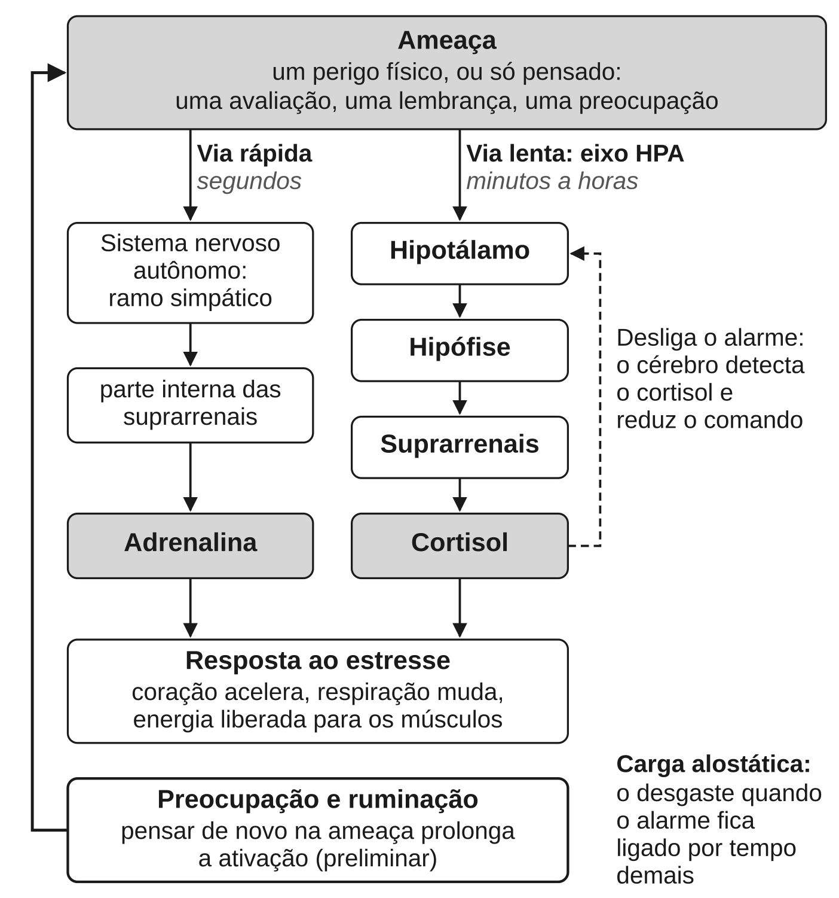

Este capítulo explica como um pensamento chega ao corpo. O caminho tem três
passos:

1. O corpo tem um alarme feito para emergências físicas.
2. Esse alarme dispara também diante de ameaças que só existem na cabeça: uma
   avaliação, uma lembrança, uma preocupação.
3. Quando ele fica ligado tempo demais, cobra um preço físico.

É aqui que a segunda flecha, apresentada no capítulo
{{cap:as-quatro-nobres-verdades-como-diagnostico}}, ganha uma fisiologia. No
fim, o capítulo separa o que se sabe bem (a fisiologia do estresse) do que
ainda é promessa (o efeito da meditação sobre hormônios, inflamação e
envelhecimento das células). Também examina uma teoria muito popular que os
especialistas rejeitam.

## O alarme e para que ele serve

**Resposta ao estresse** é o conjunto de mudanças que o corpo faz quando
detecta uma ameaça. O coração acelera, a respiração muda, açúcar e gordura vão
para o sangue como combustível dos músculos. Funções que podem esperar, como
digestão, reparo de tecidos e reprodução, são postas de lado. É um sistema
antigo, que temos em comum com os outros mamíferos, e muito bom no que faz.

O biólogo Robert Sapolsky resumiu a ideia no título de um livro: *Por que as
zebras não têm úlcera* (*Why Zebras Don't Get Ulcers*, Sapolsky 2004). Uma
zebra perseguida por um leão liga o alarme e corre. Se escapar, o alarme
desliga. A emergência dura minutos.

O problema dos seres humanos, argumenta Sapolsky, não é o estresse agudo. É
que somos capazes de manter o mesmo sistema ligado por semanas, por coisas que
não estão acontecendo agora: uma dívida, uma reunião na quinta-feira, o que
alguém pode ter pensado de nós.

Ou seja: o alarme não é o defeito. O defeito é ele não desligar.

## Dois sistemas, duas velocidades

O alarme usa duas vias, uma rápida e uma lenta.

A via rápida é o **sistema nervoso autônomo**: a parte do sistema nervoso que
regula, sem que você decida, o coração, os vasos, a respiração, a digestão e
as glândulas. Ele tem dois ramos, que funcionam como acelerador e freio:

- o **simpático**, o acelerador, prepara o corpo para agir. Ele faz as
  suprarrenais (duas pequenas glândulas sobre os rins) soltarem adrenalina;
- o **parassimpático**, o freio, favorece descanso, digestão e recuperação.
  Seu nervo principal é o **nervo vago**, que sai do tronco cerebral e chega
  ao coração, aos pulmões e ao intestino.

A via lenta é hormonal. **Eixo HPA** é a cadeia de comando entre três
estruturas: o hipotálamo (uma região na base do cérebro), a hipófise (uma
glândula logo abaixo dele) e as suprarrenais. A sigla vem das iniciais em
inglês: *hypothalamus*, *pituitary*, *adrenal*.

O hipotálamo sinaliza à hipófise, que sinaliza às suprarrenais, que liberam
**cortisol**: o principal hormônio do estresse nos seres humanos. O cortisol
mobiliza energia e ajusta o sistema imune. Em condições normais, também ajuda
a desligar o próprio alarme: o cérebro percebe que o nível subiu o bastante e
reduz o comando.

| | Via rápida | Via lenta |
|---|---|---|
| Sistema | Sistema nervoso autônomo (ramo simpático) | Eixo HPA |
| Mensageiro principal | Adrenalina e nervos | Cortisol |
| Velocidade | Segundos | Minutos a horas |
| Exemplo | Coração disparado ao frear de repente | Tensão que dura a tarde inteira depois de uma discussão |

**Força da evidência: forte.** Essa fisiologia é das coisas mais bem
estabelecidas da biologia humana. Os detalhes estão em qualquer manual. A
síntese de Sapolsky continua sendo a melhor porta de entrada, ainda que alguns
pontos dela tenham envelhecido.

## A ameaça imaginada liga o alarme de verdade

Agora a parte que responde à pergunta do capítulo. Se o alarme só disparasse
diante de leões, pensamentos não fariam mal ao corpo. Mas ele dispara diante
de ameaças *psicológicas*, e isso foi medido. **Força da evidência: forte.**

::: {.relatorio}
**O estudo.** Dickerson e Kemeny (2004) reuniram 208 estudos de laboratório.
Neles, pessoas fizeram tarefas estressantes, em geral de desempenho sob
pressão, e tiveram o cortisol medido.

**O que encontrou.** As tarefas elevaram o cortisol, mas o efeito variou
muito. As maiores respostas, e as recuperações mais lentas, vieram de tarefas
que juntavam duas coisas: falta de controle sobre o resultado e **ameaça de
avaliação social**, a chance de ser julgado mal pelos outros. O cortisol não
responde igualmente a qualquer estressor.

**Força da evidência:** forte para "ameaça psicológica eleva o cortisol".
Moderada para a explicação (controle e avaliação), que é a interpretação dos
autores a partir de estudos muito diferentes entre si.
:::

O ponto decisivo: ninguém nessas tarefas corria perigo físico. O que ligou o
eixo HPA foi uma avaliação: "posso fracassar, e vão ver". O alarme não
distingue bem entre um predador e um olhar de reprovação.

O segundo passo é o tempo. Preocupação e ruminação (o pensamento repetitivo
sobre o que deu errado, descrito no capítulo {{cap:a-mente-que-divaga}})
prolongam a ativação do corpo antes e depois do evento. A reunião dura uma
hora. A preocupação com ela começa três dias antes e termina dois dias depois.

Essa hipótese foi proposta em 2006, com apoio que os próprios autores chamavam
de preliminar (Brosschot, Gerin & Thayer 2006). Dez anos depois, uma
meta-análise de 60 estudos com pessoas saudáveis mediu a ligação (Ottaviani e
colegas, 2016). Pensar repetidamente numa ameaça acompanhava pressão,
frequência cardíaca e cortisol mais altos. Os efeitos foram de pequenos a
moderados.

O mesmo trabalho encontrou menor **variabilidade da frequência cardíaca**. É
a variação natural do intervalo entre um batimento e o seguinte. Ela é usada
como marcador do funcionamento do sistema nervoso autônomo e está associada à
saúde física e mental.

- **No curto prazo**, pensar repetidamente numa ameaça mantém o corpo
  ativado. **Força da evidência: moderada**: muitos estudos, inclusive
  experimentais, apontam na mesma direção.
- **No longo prazo**, ainda não se sabe se a ruminação *causa* doença. Os
  dados de longo prazo são quase todos correlacionais, e quem rumina mais pode
  diferir de quem rumina menos em muitas outras coisas. **Força da evidência:
  preliminar.**

Aqui convém separar os registros, como este livro promete fazer:

- **O que o texto budista afirma:** a pessoa comum, atingida pela dor,
  acrescenta uma segunda flecha: aflição, lamento, resistência.
- **O que os experimentos mostram:** pensamentos sobre uma ameaça bastam para
  disparar a resposta hormonal ao estresse, e pensar neles repetidamente a
  prolonga.

As duas afirmações não são a mesma. O sutta fala de sofrimento mental; a
fisiologia fala de cortisol e frequência cardíaca. Mas apontam na mesma
direção: boa parte do custo de um evento ruim vem do que a mente faz com ele
depois. Isso não prova o budismo. Mostra que a distinção entre as duas flechas
tem um correlato que se pode medir.

## Quando o alarme não desliga: carga alostática

O neuroendocrinologista Bruce McEwen deu nome ao custo, num artigo de 1998.
Ele descreveu duas faces dos mesmos mediadores do estresse (cortisol,
adrenalina, sinais imunes):

- **Alostase** é a capacidade do corpo de manter a estabilidade *mudando*:
  subir a pressão quando você se levanta, liberar energia quando precisa
  correr. É protetora.
- **Carga alostática** é o desgaste acumulado quando essas respostas são
  acionadas com frequência demais, ou não se desligam quando a ameaça passa. É
  o preço de usar o sistema de emergência como modo normal de funcionamento.

A ideia é simples e útil: o mesmo hormônio que salva numa emergência faz
estrago quando fica alto por meses. O estresse crônico está associado a
problemas cardiovasculares, metabólicos e imunes. A carga alostática é a
moldura que liga essas associações a um mecanismo. **Força da evidência:
forte**, como moldura teórica.

A moldura também faz uma previsão que se pode medir, e ela se confirma em
parte. **Força da evidência: moderada** para "carga alostática alta acompanha
maior mortalidade". Numa meta-análise de estudos de acompanhamento, quem tinha
carga alta tinha risco 22% maior de morrer por qualquer causa (Parker e
colegas, 2022).

Duas ressalvas mudam a leitura desse número:

- É uma associação, não prova de causa.
- Os estudos variaram muito, em parte porque cada um mede a carga de um
  jeito. Ainda não existe um número único, aceito por todos, que diga "sua
  carga é X".

## Interocepção: o corpo percebido de dentro

Até aqui, o fluxo foi de cima para baixo: o pensamento liga o alarme, o alarme
muda o corpo. Mas o fluxo também corre no sentido inverso. O cérebro recebe o
tempo todo informações sobre o corpo: batimentos, respiração, tensão muscular,
estômago, temperatura. **Interocepção** é essa percepção do estado interno do
corpo, e ela é em boa parte inconsciente.

A neurocientista Lisa Feldman Barrett defende que o cérebro não apenas
*recebe* esses sinais: ele os *prevê*. O que sentimos seria em boa parte a
previsão, corrigida pelos sinais que chegam (Barrett & Simmons 2015). Esse
artigo é declaradamente de opinião: propõe um modelo, não o testa.

No livro *How Emotions Are Made* (Barrett 2017), ela vai além. Propõe que o
cérebro constrói as emoções a partir dessas previsões sobre o corpo, de
conceitos aprendidos e da cultura, em vez de dispará-las por circuitos prontos
para "medo" ou "raiva". **Força da evidência: contestada.** Essa teoria é um
dos lados de um debate em aberto: os pesquisadores das "emoções básicas"
discordam dela. Use-a como hipótese séria, não como fato estabelecido.

Por que isso importa para a meditação? Porque várias práticas, como o
escaneamento corporal e a atenção na respiração, treinam a atenção a sinais
internos. Se a teoria estiver certa, perceber o corpo com mais precisão
poderia mudar a forma como o alarme é interpretado. Um coração acelerado
poderia ser lido como "estou em perigo" ou só como "estou com o coração
acelerado".

Mas a ideia de que a prática torna essa percepção mais *precisa* não se
confirmou. **Força da evidência: contestada.** É um caso claro da diferença
entre o que praticantes relatam e o que experimentos mostram. Meditadores
*relatam* perceber melhor o corpo.

Num experimento, meditadores experientes e não meditadores tentaram detectar
os próprios batimentos, inclusive com o coração acelerado por um remédio
parecido com a adrenalina (Khalsa e colegas, 2020). Os meditadores não se
saíram melhor. O experimento é pequeno, e o peso está na meta-análise do mesmo
artigo: com mais de 700 participantes, ela também encontrou pouca evidência
de diferença.

Se a prática muda algo aqui, talvez seja a interpretação do sinal, não a
precisão. Isso ainda não foi medido de modo convincente. O capítulo
{{cap:o-corpo-o-sono-e-a-dor}} volta ao tema.

## A teoria polivagal: popular e rejeitada pela fisiologia

**Força da evidência: contestada, e em grande parte refutada nas premissas
fisiológicas.**

Quem pesquisa meditação, ioga ou terapia corporal na internet encontra cedo a
**teoria polivagal**, proposta pelo psiquiatra Stephen Porges (Porges 2011).
É popular, e, como se verá, a fisiologia rejeita suas premissas. Ela afirma que o nervo vago tem dois ramos com papéis evolutivos distintos:

- um "ventral", ligado à segurança e à conexão social;
- um "dorsal", ligado a paralisia e desligamento.

Daí vem um vocabulário muito difundido, como "ativar o vago ventral" ou "estado
dorsal". E vem a promessa de que certas respirações ou práticas "colocam você
em modo de segurança".

O problema é que as premissas fisiológicas da teoria são rejeitadas por um
grupo amplo de especialistas no sistema nervoso autônomo. Em 2023, o
psicofisiologista Paul Grossman examinou as cinco premissas básicas e
argumentou que cada uma é insustentável ou muito improvável (Grossman 2023).
Um exemplo: a teoria trata uma parte da variabilidade da frequência cardíaca
como medida direta da atividade do vago. Para Grossman, isso confunde um
indicador aproximado com o fenômeno que ele indica.

Em 2026, Grossman e outros 38 especialistas na fisiologia e na evolução do
nervo vago foram mais longe (Grossman et al. 2026). Muitos deles eram citados
pela própria literatura polivagal como apoio. A conclusão: a teoria é
insustentável diante do que se sabe hoje de neurofisiologia e de evolução.

Porges respondeu que a crítica ataca uma versão reconstruída da teoria (Porges
2026). A resposta é conceitual: não traz dados novos contra as objeções
anatômicas.

Isso não significa que respirar devagar não acalme, nem que o nervo vago não
participe da regulação do coração. Ele participa. Significa que a
*explicação* polivagal não se sustenta. Frases como "esta prática ativa seu
vago ventral" são vocabulário de marketing, não fisiologia.

## O que a meditação faz com o alarme

A pergunta natural: se o pensamento liga o alarme, treinar a relação com os
pensamentos o desliga? A resposta curta:

- quem medita *relata* menos estresse, com bastante consistência;
- o corpo acompanha pouco e de modo irregular;
- ainda não se sabe se essas pequenas mudanças fazem diferença para a saúde.

Marcador por marcador, o quadro é este:

| Marcador | O que a pesquisa mostra | Força da evidência |
|---|---|---|
| Cortisol | Redução média pequena a moderada, mas irregular; depende da prática, da medida e de quem pratica | preliminar |
| Inflamação | Talvez uma redução pequena; a análise mais cautelosa encontra quase nada | preliminar |
| Variabilidade da frequência cardíaca | Nenhum efeito detectável em repouso | preliminar |
| Telômeros | Um ensaio de 18 meses não encontrou proteção | contestada |
| Relógio epigenético | Nenhuma diferença num estudo comparativo; falta um ensaio | preliminar |

## Cortisol

**Força da evidência: preliminar.** A redução média é de pequena a moderada, aparece mais em
pessoas doentes ou sob muito estresse, e não aparece em todos os estudos.

As sínteses de ensaios randomizados encontram, em média, uma redução pequena a moderada
do cortisol em pessoas sem diagnóstico (Rogerson e colegas, 2024). Nos
ensaios só com o MBSR, ela continua aparecendo, menor, contra controles
ativos, a comparação que o capítulo {{cap:como-saber-se-algo-funciona}}
explica por que importa (Johnson e colegas, 2026). Um dos autores dessa
síntese desenvolve programas de mindfulness, e cortisol mais baixo não é, por
si, saúde melhor.

O resultado depende de quem pratica e de como se mede. No sangue, a redução só
apareceu em pessoas com alguma doença física. Na saliva, não houve efeito
detectável (Koncz e colegas, 2021).

E a síntese mais ampla não encontrou efeito no corpo. Com mais de 23 mil
trabalhadores, ela viu melhora no estresse relatado, na ansiedade e no sono.
Mas não viu diferença detectável no cortisol, na pressão arterial, na variabilidade da
frequência cardíaca nem na inflamação (Khanal e colegas, 2026).

Parte das contradições vem da medida. O cortisol da saliva e do sangue mostra
o nível de um momento. O do cabelo reflete a exposição acumulada nos meses
anteriores. Um mesmo projeto mostra a diferença.

::: {.relatorio}
**O estudo.** O *ReSource Project*, em Leipzig e Berlim, um dos maiores
estudos de treino mental laico. Até nove meses de prática quase diária, em
módulos de três meses: atenção ao presente e ao corpo (o mais parecido com os
programas de mindfulness comuns), compaixão e tomada de perspectiva. Engert e
colegas (2017) testaram 313 pessoas num teste padronizado de estresse social:
a *reação* aguda. Puhlmann e colegas (2021) mediram o cortisol no cabelo: a
*exposição* ao longo de meses. Os participantes sabiam que estavam treinando
(um ensaio aberto), e um grupo de comparação só fazia os testes.

**O que encontrou.** Na reação aguda, os três módulos reduziram o estresse
*relatado*. Só os módulos sociais reduziram a liberação de cortisol, em até
51%. O módulo de atenção mudou o relato, não o hormônio, e nenhuma prática
mudou os marcadores autonômicos e imunes. No cabelo, o cortisol caiu nos
primeiros três a seis meses em todos os grupos que treinaram, inclusive num
que começou pelo módulo de atenção. Ficou estável no grupo sem treino. Caiu
mais em quem praticava com mais frequência, e não acompanhou a mudança no
estresse relatado.

**Força da evidência:** preliminar. Um único projeto e grupo de pesquisa, com
pessoas saudáveis. O tipo de prática parece importar para a reação aguda,
talvez não para a exposição de longo prazo. Não se sabe se a queda dura, nem
se melhora a saúde.
:::

"Meditação reduz o cortisol", portanto, é uma frase grande demais. Depende do
tipo de prática, da medida e de quem é comparado com quem. E "meditação" não é
uma intervenção única, ponto que volta no capítulo
{{cap:bondade-e-compaixao-como-treino}}.

## Variabilidade, inflamação, envelhecimento

**Variabilidade da frequência cardíaca. Força da evidência: preliminar**: por
ora, não há evidência de que a meditação a aumente. Muito do que se diz sobre
meditação e "tônus vagal" supõe que sim. Uma meta-análise de 19 ensaios
randomizados não encontrou efeito sobre a variabilidade em repouso (Brown e
colegas, 2021). O efeito aparente, que já não se distinguia do acaso, caía pela metade quando se retirava
um único estudo com resultado extremo.

**Inflamação. Força da evidência: preliminar**: talvez haja uma redução
pequena. A primeira revisão de ensaios chamou seus próprios resultados de
provisórios, e pediu que fossem repetidos (Black & Slavich 2016). Uma análise
posterior reuniu mais de cem ensaios de terapias psicológicas. Para o
mindfulness, encontrou uma redução pequena a moderada, com estudos muito
diferentes entre si (Ballesio e colegas, 2023). A mais cautelosa, com o plano de análise
registrado antes, encontrou uma redução muito pequena, no limite do acaso, e
sinais de viés de publicação (Grasmann e colegas, 2023).

**Telômeros. Força da evidência: contestada**: num teste direto, a meditação
não os protegeu. **Telômeros** são as pontas protetoras dos cromossomos. Seu
encurtamento acompanha o envelhecimento das células e foi associado a estresse
crônico.

A ideia de que a meditação poderia protegê-los vem de um artigo de 2009 cujo
título é uma pergunta: *a meditação pode desacelerar o envelhecimento
celular?* (Epel et al. 2009). O artigo propõe uma hipótese; não testa
nenhuma. Os sinais a favor vêm de poucos estudos, a maioria sem sorteio: uma
revisão de 2021 achou só cinco (Dasanayaka e colegas, 2021).

O teste direto veio depois, numa análise secundária do ensaio Age-Well
(Kaliman e colegas, 2025).
Pessoas com 65 anos ou mais foram sorteadas para três grupos: 18 meses de
meditação, 18 meses de aula de língua estrangeira, ou nenhuma atividade. Não
houve diferença entre os grupos no comprimento dos telômeros.

**Relógio epigenético. Força da evidência: preliminar.** O relógio epigenético
é a idade biológica estimada por marcas químicas no DNA. Num estudo
comparativo, ele não diferiu, em média, entre meditadores e não meditadores
(Chaix e colegas, 2017). Quem medita não foi sorteado para meditar, e ainda
falta um ensaio randomizado.

Manchetes como "meditação rejuvenesce suas células" estão muitos passos à
frente dos dados.

A pressão arterial tem estudos próprios, apresentados no capítulo
{{cap:o-corpo-o-sono-e-a-dor}}.

## O balanço

Está bem estabelecido que quem medita relata menos estresse. Que o corpo
acompanhe é muito menos claro. Isso ainda não se sabe porque:

- os estudos são em geral pequenos e curtos;
- medem coisas diferentes com o mesmo nome;
- nenhum acompanhou pessoas por tempo suficiente para ver se as pequenas
  mudanças biológicas se traduzem em menos doença.

Uma ressalva de saúde, sem rodeio: estresse crônico intenso, ansiedade que
atrapalha a vida, insônia persistente e sintomas físicos sem explicação são
motivos para procurar um profissional de saúde. A meditação pode ser uma parte
do cuidado; não é um substituto para o tratamento.

## O que fica estabelecido

- A **resposta ao estresse** é um alarme de emergência com duas vias: o
  **sistema nervoso autônomo** (rápido, com acelerador simpático e freio
  parassimpático) e o **eixo HPA**, que libera **cortisol** (lento).
- O alarme dispara diante de ameaças psicológicas: avaliação social e falta de
  controle elevam o cortisol sem nenhum perigo físico (forte). Pensar
  repetidamente na ameaça mantém o corpo ativado no curto prazo (moderada);
  ainda não se sabe se isso causa doença ao longo dos anos (preliminar).
- O custo vem da duração: a **carga alostática** é o desgaste de um sistema de
  emergência usado como rotina. Carga alta acompanha maior mortalidade
  (moderada), mas ainda não há uma medida-padrão.
- **Interocepção** é a percepção do estado interno do corpo. A teoria das
  emoções construídas a partir de previsões sobre o corpo é contestada; e
  meditadores não detectam os batimentos com mais precisão (contestada).
- A **teoria polivagal** é popular, mas suas premissas fisiológicas são
  rejeitadas por um grupo amplo de especialistas no nervo vago; o autor
  contesta a crítica, sem dados novos (contestada).
- **Meditação e corpo:** o estresse relatado cai com consistência; o cortisol
  cai de pouco a moderadamente e de modo irregular, e a inflamação talvez caia um pouco
  (preliminar); não há efeito demonstrado sobre a **variabilidade da
  frequência cardíaca** (preliminar); um ensaio de 18 meses sobre
  **telômeros** não encontrou proteção (contestada).
- **O que ainda não se sabe:** se as pequenas mudanças biológicas duram, se
  melhoram a saúde, e qual tipo de prática as produz.
- A segunda flecha do texto budista e a ativação prolongada medida em
  laboratório apontam na mesma direção. Isso é convergência, não prova.
