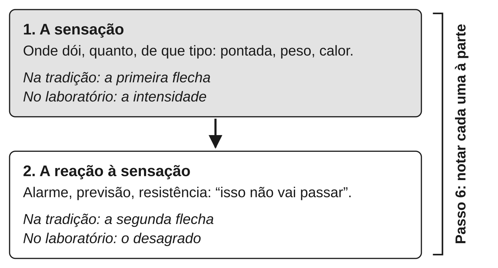

Este capítulo ensina o escaneamento corporal e examina duas promessas feitas
em nome dele e de práticas parecidas: dormir melhor e sentir menos dor. A
resposta curta é que as duas têm evidência real e modesta.

- **Sono:** a meditação melhora o sono um pouco, mas não mais do que o
  tratamento próprio para insônia.
- **Dor crônica:** a meditação reduz a dor um pouco, com evidência de
  qualidade baixa.
- **Pressão arterial:** o sinal também é pequeno e ainda incerto.

Na pesquisa sobre dor, o mais interessante não é quanto a dor diminui. É
*o que* muda: a relação com a sensação, mais do que a sensação em si. É a
segunda flecha outra vez, agora no corpo.

## O que é o escaneamento corporal

**Escaneamento corporal** (em inglês, *body scan*) é uma prática em que a
atenção percorre o corpo devagar, de uma ponta à outra. Em cada região, ela
para e nota o que está lá: calor, pressão, formigamento, tensão, dor, ou
nada que se perceba. Não se tenta relaxar a região, mudá-la ou imaginá-la
diferente. Só se nota, e segue-se adiante.

A prática, no formato em que ficou conhecida, vem do programa MBSR (definido
no capítulo {{cap:o-que-a-ciencia-da-meditacao-mostra-e-o-que}}). O livro do
programa para o público, *Full Catastrophe Living*, de Jon Kabat-Zinn
(1990), a apresenta como uma das práticas centrais do curso, feita deitado.

Ela tem parentesco com a tradição, mas não é uma cópia dela. No
*Satipaṭṭhāna Sutta*, o corpo é a primeira das quatro bases da atenção
(apresentadas no capítulo {{cap:observar-sem-agarrar}}). O texto inclui
contemplações do corpo parte por parte, com um propósito: ver o corpo surgir
e passar, sem se agarrar a nada. O MBSR guarda o corpo como objeto de
atenção, mas troca esse propósito por um objetivo clínico: aprender a estar
com sensações, inclusive as difíceis. É uma adaptação, e é dito como
adaptação.

Por que o corpo? Há duas razões, uma prática e uma teórica.

- **A prática:** sensações do corpo estão sempre presentes e acontecem
  *agora*. Uma sensação no pé não está no passado nem no futuro, como um
  pensamento pode estar. Isso faz do corpo uma âncora natural.
- **A teórica:** perceber o estado interno do corpo — a interocepção,
  definida no capítulo {{cap:estresse-o-alarme-que-nao-desliga}} — participa
  da forma como o cérebro constrói emoções e avalia ameaças. Treinar essa
  percepção seria, em princípio, treinar uma das entradas do sistema de
  alarme. "Em princípio" importa: é um argumento teórico plausível, não um
  efeito medido do escaneamento. A versão técnica dele está em Barrett e
  Simmons (2015).

## Como fazer

A versão abaixo leva de dez a vinte minutos. Pode ser feita deitado ou
sentado. Deitado é mais confortável e, por isso mesmo, dá mais sono, o que
será uma vantagem ou um problema conforme a hora.

1. **Deite-se de costas**, braços ao lado do corpo, ou sente-se com apoio.
   Feche os olhos, se for confortável. Dê três respirações um pouco mais
   lentas e depois deixe a respiração no ritmo dela.
2. **Comece pelos dedos do pé esquerdo.** Leve a atenção até eles e note o
   que houver: contato com o lençol, temperatura, formigamento. Se não sentir
   nada, note "nada" — isso também é uma observação.
3. **Suba devagar:** planta do pé, calcanhar, tornozelo, canela, joelho,
   coxa. Fique em cada região o tempo de uma ou duas respirações.
4. **Repita do lado direito**, depois quadril, abdômen, costas (de baixo para
   cima), peito, ombros, braços até as mãos, pescoço, rosto, alto da cabeça.
5. **Quando a atenção sair** — e ela vai sair, para um plano, uma lembrança,
   um comentário sobre a prática —, note para onde foi. Depois volte à última
   região de que se lembra. É o mesmo movimento de voltar ensinado no
   capítulo {{cap:atencao-na-respiracao}}.
6. **Quando encontrar desconforto**, não o empurre e não se demore nele por
   obrigação. Note as qualidades da sensação: pontada ou peso? Fixa ou
   pulsando? Com borda ou difusa? Depois note, separadamente, a reação a ela
   ("de novo isso", "vai piorar"). Essa separação é o exercício.
7. **Termine com o corpo inteiro**: por algumas respirações, sinta o corpo
   como um todo, deitado, respirando.

**Antes de dormir.** Feito na cama, com a luz apagada, o escaneamento
dispensa o último passo. Se o sono vier no meio do caminho, a prática
cumpriu o que você queria dela naquela noite. Duas cautelas:

- **Não use o escaneamento para *forçar* o sono.** Quanto mais ele vira uma
  tarefa com meta, mais lembra a vigília ansiosa que se quer largar.
- **Se quiser treinar a atenção, e não só adormecer**, faça também uma
  sessão em outro horário, sentado, com o objetivo de ficar acordado.

**Se o corpo for um lugar difícil.** Algumas pessoas têm história de
trauma, dor intensa ou ansiedade com sensações do corpo (como no pânico).
Para elas, voltar a atenção para dentro do corpo pode aumentar o desconforto
em vez de diminuí-lo. Nesse caso, abra os olhos e encurte a prática. Use
âncoras externas, como sons ou a sola dos pés no chão. E veja o capítulo
{{cap:quando-a-meditacao-da-errado}}.

## O sono: o que a pesquisa mostra

**Resposta curta:** a meditação melhora o sono um pouco em comparação com
atividades de controle (evidência **moderada**). Mas não supera o tratamento
próprio para insônia, que é a TCC-I (evidência **forte**).

**Insônia** é a dificuldade persistente de começar a dormir ou de manter o
sono, ou de acordar cedo demais sem conseguir voltar a dormir. Ela traz prejuízo no dia seguinte:
cansaço, irritação, dificuldade de concentração. Uma noite ruim não é
insônia. A insônia crônica é um padrão que se mantém por semanas ou meses.

O fato que organiza o resto: **o tratamento de primeira escolha para a
insônia crônica em adultos não é remédio nem meditação. É a TCC-I.**

**TCC-I** é a terapia cognitivo-comportamental para insônia. É um tratamento
estruturado de algumas semanas. Ele trabalha os hábitos e as crenças que
mantêm a insônia: horários de deitar e levantar, tempo na cama, o que se faz
quando não se dorme, a preocupação com o próprio sono. Uma diretriz
americana de clínica médica (2016) a recomenda como tratamento inicial para
todos os adultos com insônia crônica. A diretriz europeia de 2023 a
recomenda como primeira linha para adultos de qualquer idade, presencial ou
digital. A força é **forte** porque duas diretrizes independentes, baseadas em revisões
sistemáticas, chegam à mesma conclusão.

É contra esse pano de fundo que os estudos de meditação devem ser lidos.

::: {.relatorio}
**O estudo.** Rusch e colegas, publicado em 2019. Meta-análise de 18 ensaios
randomizados, com 1.654 participantes, sobre meditação mindfulness e
qualidade do sono. Os autores separaram dois tipos de comparação: contra
controles ativos *inespecíficos* (atividades que igualam tempo e atenção,
para controlar o efeito placebo) e contra controles ativos *específicos*
(tratamentos de sono com eficácia comprovada).

**O que encontrou.** Contra controles inespecíficos, a meditação melhorou a
qualidade do sono, com tamanho de efeito de 0,33 logo após a intervenção e
0,54 no seguimento — evidência de força moderada, segundo os autores. Contra
tratamentos específicos de sono, não houve diferença (tamanho de efeito de
0,03, com intervalo de confiança cruzando o zero).

**Força da evidência:** moderada para "a meditação melhora um pouco o sono";
baixa, mas consistente com as diretrizes, para "ela não supera o tratamento
próprio para insônia". Os autores chamam os achados de preliminares.
:::

O efeito sobre o sono é pequeno a moderado (os termos estão no capítulo
{{cap:como-saber-se-algo-funciona}}). É perceptível em média, mas longe de
transformador.

O resultado mais impressionante vem de um estudo só. Um ensaio de 2015
sorteou 49 adultos mais velhos com problemas moderados de sono. Um grupo fez
seis semanas de prática de atenção plena; o outro, aulas de higiene do sono. O
grupo de meditação melhorou mais no sono, com um efeito grande, e também em
sintomas de insônia, depressão e fadiga. O controle era ativo e razoável.
Mas é um ensaio pequeno e único, e efeitos grandes em estudos pequenos
tendem a encolher quando outros estudos se somam (o porquê está no capítulo
{{cap:como-saber-se-algo-funciona}}). Força: **preliminar**.

Nem toda revisão concorda. A revisão de 2014 que só aceitou controles ativos
(descrita no capítulo {{cap:o-que-a-ciencia-da-meditacao-mostra-e-o-que}})
classificou a evidência para sono como baixa ou insuficiente. A diferença
vem, em boa parte, de quais estudos e quais controles cada revisão incluiu.
"A meta-análise mostrou" depende de qual meta-análise.

Na prática, isso dá uma regra simples:

- **Se você dorme mal de vez em quando**, o escaneamento antes de dormir é
  uma prática razoável, barata e de baixo risco.
- **Se você tem insônia crônica, procure TCC-I.** A meditação pode
  acompanhar o tratamento, não substituí-lo.
- **Se o sono ruim vem junto de humor deprimido ou de outros sintomas**,
  isso é assunto para um médico, não para um aplicativo.

## A dor: o que a pesquisa mostra

**Resposta curta:** em dor crônica, a meditação reduz a dor um pouco, com
evidência de qualidade baixa (**moderada a preliminar**). Em laboratório, o
efeito é mais nítido, mas foi medido em pessoas saudáveis e com dor breve
(**preliminar**).

**Dor crônica** é dor que persiste por mais de três meses. É esse o critério
proposto para a CID-11, a classificação internacional de doenças. Na forma que essa classificação
chama de dor crônica *primária*, ela vem com sofrimento emocional ou com
limitação importante do que a pessoa consegue fazer. Não é uma dor aguda que
demorou: é uma condição com vida própria.

A história do mindfulness clínico começa aqui. O artigo que fundou o MBSR
(Kabat-Zinn, 1982) descreveu 51 pacientes com dor crônica que não haviam
melhorado com o tratamento médico usual. Eles passaram por um programa de
dez semanas, e a maioria relatou menos dor e menos sofrimento emocional. O
estudo não tinha grupo controle, e o próprio artigo se apresenta como
preliminar. Ele importa pela história, não como prova.

A hipótese de Kabat-Zinn, porém, merece atenção. Ele propôs que a meditação
"desacoplasse" a sensação da dor da reação de alarme que vem com ela. É,
quase palavra por palavra, a distinção entre a primeira e a segunda flecha.
É também a distinção entre intensidade e desagrado no estudo de Rainville,
apresentado no capítulo {{cap:as-quatro-nobres-verdades-como-diagnostico}}.

Mais de quarenta anos depois, o que se sabe?

- **Em dor crônica, os efeitos são pequenos e a evidência é de baixa
  qualidade.** Uma revisão sistemática de 2017 reuniu 38 ensaios
  randomizados. Encontrou uma redução *pequena* da dor em comparação com
  todos os tipos de controle, e julgou a qualidade dessa evidência baixa. Os
  efeitos sobre depressão e qualidade de vida foram mais claros que sobre a
  dor. A revisão de 2014 que só aceitou controles ativos chegou a um quadro
  parecido. Força: **moderada a preliminar**, conforme o peso que se dá à
  qualidade dos estudos.
- **Em laboratório, o efeito é mais nítido — e mais distante da vida real.**
  Zeidan e colegas (2015) sortearam voluntários saudáveis para quatro dias de
  treino. Os grupos meditaram, usaram um creme placebo, fizeram uma meditação
  falsa (instruções que imitavam a prática sem ensiná-la) ou ouviram um livro. Diante de calor na pele, todos os
  grupos ativos sentiram menos dor. A meditação reduziu a intensidade e o
  desagrado *mais* que o placebo e que a meditação falsa. Força:
  **preliminar**. Os participantes eram saudáveis, a dor era breve e
  induzida, e o resultado não mostra eficácia em dor crônica.

O estudo de Zeidan também mediu o cérebro. Encontrou padrões diferentes para
a meditação e para o placebo. A leitura correta é modesta: os dois efeitos
parecem não ser o mesmo efeito. A leitura exagerada — "a meditação ativa o
centro de controle da dor" — é inferência reversa, o erro descrito no
capítulo {{cap:como-saber-se-algo-funciona}}.

## Por que entender o mecanismo muda a relação com a dor

**Modulação da dor** é o nome para um fato bem estabelecido: a dor que se
sente não é um registro direto do que acontece no tecido. O sistema nervoso
amplifica ou atenua os sinais conforme a atenção, a expectativa, as crenças
e o contexto.

Os dois estudos de dor deste livro mostram isso por caminhos diferentes. Em
Rainville, uma sugestão hipnótica mudou o desagrado. Em Zeidan, meditação,
placebo e até uma meditação falsa reduziram a dor em alguma medida. Os
próprios autores leem o resultado como sinal de que o cérebro tem vários
mecanismos para modular a dor.

Isso tem uma consequência prática que vale mais do que o tamanho do efeito.
A dor tem pelo menos duas camadas: a sensação e a reação a ela. Quem
entende isso ganha um lugar onde trabalhar quando a sensação não pode ser
mudada.

O passo 6 do escaneamento treina exatamente isto. Primeiro, descrever a
sensação com precisão ("pontada, à direita, pulsando"). Depois, notar à
parte a camada de alarme, previsão e resistência ("isso não vai passar",
"não aguento mais"). Nem a tradição nem o laboratório prometem que a
primeira flecha some.

Três cuidados para não transformar isso em culpa:

1. **"A dor está na cabeça" é uma leitura errada.** Dizer que o cérebro
   modula a dor não é dizer que ela é imaginária. Toda dor é processada pelo
   cérebro, inclusive a de uma fratura.
2. **Se a prática não reduz sua dor, você não fez nada errado.** Os efeitos
   médios são pequenos; para muita gente, eles não aparecem.
3. **Meditação não substitui tratamento para dor.** Dor nova, dor que muda
   de padrão ou dor que vem com outros sintomas precisa de avaliação médica.
   Para dor crônica, a meditação entra como complemento do cuidado orientado
   por um profissional de saúde, não no lugar dele.

## A pressão arterial: o que a pesquisa mostra

**Resposta curta:** a meditação talvez baixe a pressão em alguns
milímetros de mercúrio (evidência **preliminar**). Não se sabe se o efeito
dura nem se ele evita infartos e derrames.

**Pressão arterial** é a força do sangue contra a parede das artérias. Ela é
medida em milímetros de mercúrio (mmHg), por dois números: a sistólica,
quando o coração se contrai, e a diastólica, entre um batimento e outro.
Pressão alta é um dos principais fatores de risco para doença
cardiovascular. É o ponto em que o estresse do capítulo
{{cap:estresse-o-alarme-que-nao-desliga}} encontra um número que os médicos
acompanham.

A Meditação Transcendental, uma técnica de meditação diferente das que este
livro ensina, tem estudos próprios sobre o tema. Uma meta-análise de 2022, com 18 estudos, encontrou queda de
cerca de 3 mmHg na sistólica. Mas o efeito se desfez depois de três meses.

Para o mindfulness, há um ensaio recente que vale examinar, o MB-BP. Ele
encontrou uma vantagem de alguns mmHg. Mas foi conduzido pelo criador do
programa, contra um controle sem atividade equivalente.

::: {.relatorio}
**O estudo.** O ensaio MB-BP (Loucks e colegas, 2023), de fase 2 — um
ensaio intermediário, feito antes de um teste definitivo. Sorteou 201
adultos com pressão elevada (a partir de 120/80 mmHg) para um programa de
mindfulness adaptado à pressão alta ou para o cuidado habitual reforçado
(o mesmo aparelho de medir a pressão em casa e um folheto educativo, sem
programa equivalente). Quem mediu a pressão não sabia a que grupo cada
pessoa pertencia. Acompanhamento: seis meses.

**O que encontrou.** A pressão sistólica caiu 5,9 mmHg no grupo de
mindfulness e ficou 4,5 mmHg abaixo da do grupo controle, com intervalo de
confiança de −9,0 a −0,1 mmHg — perto do zero na ponta de cima.

**Força da evidência:** preliminar. Um ensaio só, com 201 pessoas, contra
um controle sem atividade equivalente, com 17,4% de perda de participantes
e uma amostra 81,1% branca não hispânica. O primeiro autor criou o
programa e foi um dos três instrutores do estudo. Ele declara não receber
dinheiro pelo programa; o desfecho principal foi registrado antes e
analisado por um estatístico independente, sem saber os grupos.
:::

As revisões confirmam um sinal e sublinham seus limites.

- **Uma meta-análise de 2026** reuniu 21 ensaios de mindfulness e encontrou
  queda de cerca de 6 mmHg na sistólica. Os autores chamam o efeito de
  grande. A conclusão vai além do que a qualidade das revisões do tema
  permite, como mostra a revisão seguinte. Nenhum dos ensaios relatou
  efeitos adversos.
- **Uma revisão das revisões, também de 2026,** julgou de qualidade baixa ou
  criticamente baixa todas as 11 que examinou, menos uma. A exceção, uma
  revisão Cochrane de qualidade alta, contra controles ativos, encontrou queda de cerca de 6 mmHg na sistólica. Mas a
  margem de incerteza desse número inclui efeito nenhum. O criador do
  programa MB-BP está entre os autores, o que pede a cautela devida a quem
  avalia um campo em que tem trabalho próprio.

**O que ainda não se sabe, e por quê.** Não se sabe se o efeito dura,
porque faltam dados de longo prazo; na Meditação Transcendental, ele se
desfez em três meses. Nem se ele reduz infartos e derrames, porque os
ensaios medem a pressão, não esses desfechos.

Quem tem pressão alta não deve trocar pela meditação o remédio nem as
mudanças de hábito recomendadas. Nem deve suspender um medicamento sem falar
com o médico. Por fim, os estudos não relatarem efeitos adversos não
significa que eles não existam. Significa só que não foram registrados
(veja o capítulo {{cap:quando-a-meditacao-da-errado}}).

## O que a tradição diz e o que a ciência diz, lado a lado

| | O que a tradição afirma | O que a pesquisa mostra |
|---|---|---|
| Atenção ao corpo | O corpo é a primeira base da atenção; contemplá-lo leva a ver a impermanência | Escaneamento é prática central do MBSR; os estudos citados avaliam programas inteiros, não o escaneamento isolado |
| Sono | Os textos citados neste livro não tratam do sono como objetivo | Melhora pequena a moderada; não supera a TCC-I |
| Pressão arterial | Os textos citados neste livro não tratam dela | Queda de alguns mmHg em ensaios pequenos e curtos; não se sabe se dura nem se evita doença |
| Dor | A segunda flecha pode cessar; a primeira não | Redução pequena da dor crônica, evidência de qualidade baixa; em laboratório, intensidade e desagrado caem |

A convergência está na última linha, e é a mesma do capítulo sobre as
Quatro Nobres Verdades: a tradição e a ciência separam a dor da reação à
dor. A divergência também está ali. A tradição fala de uma segunda flecha
que *cessa*. A ciência mede uma segunda camada que *diminui um pouco*, em
média, em algumas pessoas.

## O que fica estabelecido

- O **escaneamento corporal** percorre o corpo com a atenção, notando
  sensações sem tentar mudá-las. Vem do MBSR, que adaptou contemplações do
  corpo presentes na tradição para um objetivo clínico.
- **Sono:** meditação melhora a qualidade do sono um pouco em comparação com
  controles inespecíficos (moderada), mas não supera o tratamento próprio. O
  tratamento de primeira escolha para insônia crônica é a **TCC-I** (forte).
- **Dor crônica:** redução pequena, com evidência de qualidade baixa
  (moderada a preliminar). Em laboratório, com voluntários saudáveis, a
  meditação reduziu intensidade e desagrado mais que placebo (preliminar).
- **Modulação da dor** é real e bem estabelecida: atenção, expectativa e
  contexto mudam a dor sentida. Isso não torna a dor imaginária.
- O que a prática treina é separar a sensação da reação a ela — a mesma
  distinção da segunda flecha, agora com o corpo como objeto.
- **Pressão arterial:** a meditação talvez baixe a pressão em alguns mmHg
  (preliminar). Não se sabe se o efeito dura nem se evita infartos e
  derrames.
- Meditação não substitui tratamento para insônia, para dor nem para
  pressão alta.
