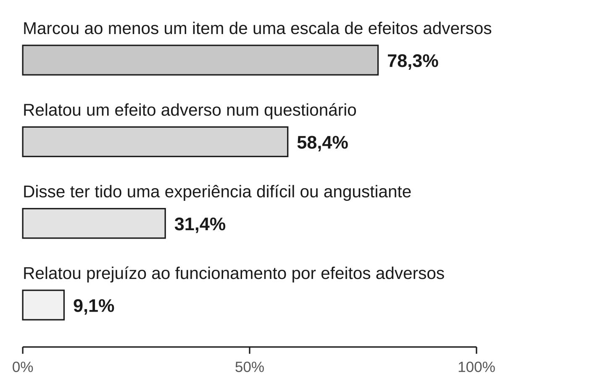

Este capítulo responde a uma pergunta que a maior parte dos livros sobre
meditação evita: ela pode fazer mal? Pode. Há efeitos adversos documentados.
Alguns passam, outros duram. E eles aparecem também em pessoas sem nenhum
histórico de problema mental. O capítulo mostra o que se sabe sobre esses
efeitos, com que frequência parecem acontecer e quando ficam mais prováveis.
E mostra como reconhecer a hora de ajustar a prática, de parar e de procurar
ajuda. O tom pretendido é o de uma bula bem escrita: nem alarme, nem folheto
que só lista benefícios.

## Por que este capítulo existe

A pesquisa sobre meditação mediu sobretudo benefícios. Um exemplo: numa
revisão de 38 ensaios sobre dor crônica, só sete relataram dados de
segurança. Britton e colegas (2021) descrevem a pesquisa sobre efeitos
adversos em programas de mindfulness como escassa e pouco precisa no método.
O resultado foi uma imagem pública em que meditar é, na pior das hipóteses,
inútil.

Essa imagem não vem da tradição. Lindahl e colegas (2017) observam que as
próprias fontes textuais budistas, de onde os programas modernos tiram os
benefícios, também reconhecem outros efeitos da prática, além dos ligados à
saúde. Na passagem para o bem-estar, não se perdeu o conhecimento de que a
prática pode desestabilizar. Perdeu-se o hábito de falar disso.

Vale separar os três registros, como em todo o livro:

- **O que os textos afirmam:** que a prática séria pode atravessar estados
  difíceis.
- **O que praticantes relatam:** experiências desse tipo, às vezes graves.
- **O que os estudos mostram:** que efeitos negativos acontecem também em
  programas clínicos curtos, e com que frequência aproximada.

Este capítulo fica sobretudo no terceiro registro.

## O que conta como efeito adverso

**Efeito adverso**, em saúde, é qualquer efeito indesejado associado a um
tratamento ou prática. Vai da dor de cabeça causada por um remédio à piora de
um sintoma durante uma terapia. Para meditação, a definição precisa de dois
cuidados.

O primeiro é separar efeito adverso de **desconforto esperado**. Tédio,
inquietação, dor no joelho, sono, a descoberta irritante de que a mente não
para: isso faz parte de aprender, como a dor muscular faz parte de começar a
correr. Também faz parte da prática encontrar emoções que estavam ali e eram
evitadas. Nada disso, por si, é sinal de que algo deu errado.

O segundo cuidado é perguntar mais de uma coisa. A equipe de Willoughby
Britton criou uma entrevista que, para cada experiência, investiga cinco
pontos:

1. se ela ocorreu;
2. se está ligada à prática de meditação;
3. quanto durou;
4. se foi sentida como boa ou ruim;
5. se prejudicou o funcionamento da pessoa: no trabalho, no sono, nas
   relações.

Uma experiência desagradável que passa em minutos e uma que impede a pessoa
de trabalhar por semanas não são a mesma coisa. Contá-las juntas engana nos
dois sentidos.

## O mapa das experiências difíceis

O estudo que organizou o campo foi o *Varieties of Contemplative Experience*,
de Jared Lindahl, Willoughby Britton e colegas (2017). Eles entrevistaram
praticantes ocidentais de tradições Theravāda, Zen e tibetana, além de
professores de meditação e clínicos. Com o que ouviram, montaram uma
classificação de **59 tipos de experiência, em 7 domínios**: pensamento,
percepção, emoção, corpo, motivação e vontade, senso de si e vida social.

Alguns exemplos, com os nomes que o próprio estudo usa:

| Domínio | Exemplos de categorias |
|---|---|
| Perceptivo | hipersensibilidade a estímulos; distorções de tempo ou espaço; desrealização (o mundo parece irreal) |
| Afetivo | medo, ansiedade, pânico ou paranoia; depressão ou luto; reexperiência de memórias traumáticas; embotamento emocional |
| Somático | alterações do sono; movimentos involuntários; alterações cardíacas; dor; fadiga |
| Senso de si | perda do senso de agência; mudança no senso de habitar o corpo; alteração dos limites entre eu e mundo |

Duas observações impedem a leitura errada dessa tabela.

**Primeiro, o estudo não mede frequência.** Os participantes foram escolhidos
*porque* tinham tido experiências difíceis. Os pesquisadores buscaram de
propósito os casos extremos, por indicação de professores. O estudo mostra
que essas experiências existem e como são, não quantos praticantes as têm.

**Segundo, a mesma experiência pode ser vivida de formas opostas.** Mesmo
quando a descrição era parecida, a interpretação e a resposta variavam muito
entre os participantes. Para uns a experiência foi muito boa, para outros
muito ruim. O sofrimento ia de mínimo e passageiro a grave e duradouro. Uma
mudança no senso de si pode ser lida por um praticante como progresso e, por
outro, como colapso.

Um termo dessa família precisa de definição, porque aparece em relatos e
consultórios. **Despersonalização** é a sensação persistente de estranhamento
de si mesmo. É como assistir à própria vida de fora, como se os pensamentos,
as emoções ou o corpo não fossem seus. Quando o estranhamento recai sobre o
mundo em volta, fala-se em desrealização.

Uma sensação desse tipo por instantes, durante uma prática, não é por si
sinal de problema. O sinal de alerta é quando ela persiste depois da sessão,
assusta e atrapalha a vida.

## Com que frequência

A resposta curta: **experiências desagradáveis são comuns; prejuízo ao
funcionamento atinge uma minoria, perto de uma pessoa em cada dez nos
levantamentos; prejuízo duradouro é mais raro.** Para a frequência, a
evidência é **preliminar**: os números variam muito de um estudo para outro.
Para a existência dos efeitos, a evidência é **moderada**: vários grupos, com
métodos diferentes, chegam à mesma conclusão.

A variação dos números tem uma explicação principal: as perguntas são
diferentes. Um levantamento de 2025, com uma amostra de adultos americanos
parecida com a população, mostrou isso de forma direta. Mediu a mesma coisa
de quatro jeitos, nas mesmas pessoas. O resultado foi de cerca de uma em cada
dez a quase oito em cada dez, conforme a pergunta.

O tipo de estudo também pesa:

- **Ensaios que não perguntam ativamente** por efeitos negativos tendem a
  registrar só o que o participante conta por iniciativa própria.
- **Levantamentos com praticantes** perguntam diretamente e cobrem anos de
  prática, inclusive retiros.
- **Uma pergunta única** sobre "experiência desagradável" capta coisas leves
  e graves juntas.

Uma revisão de 83 estudos, de Farias e colegas (2020), mostra o peso do tipo
de estudo. Nos estudos experimentais, menos de 4% dos participantes tiveram
eventos adversos. Nos observacionais, cerca de um terço. A revisão encontrou
eventos também em pessoas sem histórico de problemas de saúde mental.

Nos levantamentos com praticantes, os números são mais altos. No de Schlosser
e colegas (2019), com meditadores regulares, cerca de um quarto disse já ter
tido experiências particularmente desagradáveis que atribuía à meditação.

Prejuízo duradouro é o dado mais raro. Num levantamento de 2022 com uma
amostra da população americana, cerca de uma em cada dez pessoas que já
tinham meditado relatou algum prejuízo ao funcionamento. Prejuízo que durou
um mês ou mais apareceu em pouco mais de uma em cada cem. E quem relatou
efeitos adversos disse estar tão satisfeito por ter meditado quanto quem não
relatou.

O estudo que mediu com mais cuidado acompanhou pessoas num programa clínico
de oito semanas:

::: {.relatorio}
**O estudo.** Britton e colegas, publicado em 2021. 96 pessoas fizeram uma de
três variantes de um programa de oito semanas de MBCT (a terapia cognitiva
baseada em mindfulness, definida no capítulo
{{cap:o-que-a-ciencia-da-meditacao-mostra-e-o-que}}). Um entrevistador
independente aplicou uma entrevista de 44 itens sobre efeitos da meditação.
Para cada item, perguntou a ocorrência, a ligação com a prática, a duração,
se foi bom ou ruim e o impacto no funcionamento.

**O que encontrou.** 83% relataram pelo menos um efeito ligado à meditação
(bom ou ruim). Efeitos sentidos como ruins apareceram em 58%; efeitos que
prejudicaram o funcionamento, em 37%. **Efeitos ruins duradouros ocorreram em
6% a 14%** da amostra. Eles vieram junto com sinais de excitação desregulada:
hiperexcitação (um estado de alerta excessivo) e dissociação. Os autores
concluem que o sofrimento passageiro e os impactos negativos ocorreram em
taxas semelhantes às de outros tratamentos psicológicos.

**Força da evidência:** moderada. A medição foi cuidadosa e independente, mas
a amostra é modesta e de um único programa.
:::

O estudo de Britton mostra o efeito de perguntar com cuidado. A mesma amostra
dá números muito diferentes conforme se conte qualquer experiência negativa
ou só as duradouras. Nenhum desses números é "a" taxa.

## Quando o risco aumenta

A resposta curta: **alguns sinais se repetem entre os estudos, mas a evidência
é preliminar.** São estudos de associação: mostram o que aparece junto, não
o que causa o quê. Os sinais:

- **Intensidade e quantidade.** Um **retiro intensivo** é um período de
  vários dias, às vezes semanas ou meses, dedicado quase só à prática formal.
  São muitas horas por dia, em geral em silêncio. No levantamento de
  Schlosser, ter ido a um retiro em algum momento se associou a mais
  experiências desagradáveis. Isso não prova que o retiro as causou: quem vai
  a retiros pratica mais, e de outro jeito. Mas é coerente com o que
  professores e praticantes relatam.
- **Tipo de prática.** No mesmo levantamento, quem fazia só práticas
  "desconstrutivas" relatou mais experiências desagradáveis. São as práticas
  que investigam a natureza da experiência e do eu, como a vipassanā
  (definida no capítulo {{cap:o-caminho-e-onde-a-meditacao-entra-nele}}).
- **Pensamento negativo repetitivo.** Ali também, pessoas com mais tendência
  à ruminação relataram mais experiências desagradáveis.
- **Excitação desregulada.** No estudo de Britton, os efeitos duradouros
  vieram junto com hiperexcitação e dissociação.
- **Adversidade na infância.** No levantamento de 2022, ela se associou a
  mais risco de efeitos adversos.
- **Sofrimento psicológico e experiências incomuns.** No levantamento de
  2025, quatro fatores se associaram a mais efeitos adversos: sofrimento
  psicológico, traços de psicoticismo, crenças incomuns e ter ido a retiros.
- **Trauma.** Num ensaio de programas de mindfulness para depressão ativa, de
  2025, trauma na infância previu efeitos adversos duradouros. Sintomas de
  estresse pós-traumático abaixo do limiar de diagnóstico também. O ensaio é
  pequeno, mas aponta na mesma direção dos levantamentos.

Alguns fatores apareceram como *protetores* no levantamento de Schlosser:
mulheres e participantes religiosos relataram menos experiências
desagradáveis. O estudo não permite dizer por quê.

Um ponto tem de ficar claro. Farias e colegas encontraram efeitos adversos
também em pessoas sem histórico de problemas de saúde mental. Não há como
saber de antemão quem vai ter dificuldade.

Mas quem já tem histórico de trauma, psicose, transtorno bipolar, dissociação
ou depressão grave tem boas razões para duas coisas: praticar com orientação
qualificada e conversar antes com quem o acompanha. Para trauma, essas razões
já têm apoio nos estudos acima. Para os outros grupos, são razões de
prudência, porque os estudos ainda não medem bem o risco neles.

## Nem alarme, nem minimização

Há dois erros simétricos possíveis com esses números.

**O erro do alarme** é concluir que meditar é perigoso. Os números de Britton
precisam ser lidos com a conclusão dos próprios autores: as taxas foram
semelhantes às de outros tratamentos psicológicos. Tratamentos psicológicos
em geral causam algum desconforto passageiro em parte das pessoas. Isso não é
argumento contra eles. É argumento para fazê-los com alguém que saiba o que
fazer quando algo piora.

Nos estudos experimentais reunidos por Farias, a taxa de eventos adversos
ficou abaixo de 4%. A maior parte das pessoas não tem problema. Práticas
curtas como as deste livro são de risco baixo: baixo, não zero.

**O erro da minimização** é tratar qualquer dificuldade como "parte do
processo" e mandar a pessoa praticar mais. É um erro perigoso, porque
transforma um sinal em obstáculo a ser vencido. Muitos praticantes e
professores leem estados difíceis como sinal de progresso, e às vezes podem
ser. Lindahl e colegas registraram justamente essa diversidade de leituras.
Mas um professor que só tem essa leitura disponível não serve a quem está
afundando.

## Ajustar, parar, procurar ajuda

O que segue é orientação prática de prudência, não protocolo clínico. Ela
organiza os sinais em três níveis.

**Ajustar a prática** quando surgir desconforto moderado que passa depois da
sessão: inquietação, emoção forte, sensações estranhas no corpo.

1. Encurte as sessões. Cinco minutos bem feitos valem mais que trinta
   aguentados.
2. Abra os olhos e mude a âncora para algo externo ou estável: sons, os pés
   no chão, o peso do corpo na cadeira.
3. Troque a prática sentada por uma prática em movimento, como a caminhada
   atenta, ou por uma prática de bondade (o capítulo
   {{cap:bondade-e-compaixao-como-treino}}).
4. Faça atividades que "aterram": exercício, comer, conversar, tarefas
   práticas com as mãos.

**Parar e conversar com um professor ou profissional** quando:

- os efeitos durarem além da sessão por dias;
- o sono piorar de forma persistente;
- surgirem ataques de pânico, despersonalização que não passa ou memórias
  traumáticas invasivas;
- você notar que trabalho e relações estão sendo afetados.

Parar por um tempo não é fracasso; a prática estará lá depois.

**Procurar ajuda imediatamente** se houver:

- pensamentos de se machucar ou de acabar com a própria vida;
- perda de contato com a realidade: ouvir ou ver coisas que outros não
  percebem, certezas estranhas que não se deixam questionar;
- sofrimento que você sente que não consegue suportar.

No Brasil:

- **CVV — Centro de Valorização da Vida: ligue 188.** Apoio emocional
  gratuito, sigiloso, 24 horas por dia, em todo o país; também por chat no
  site do CVV.
- **SAMU: ligue 192** em situação de urgência, inclusive psiquiátrica e
  tentativas de suicídio. O serviço é gratuito e funciona 24 horas.
- **CAPS — Centros de Atenção Psicossocial:** serviços públicos de saúde
  mental do SUS, abertos à comunidade, que acolhem pessoas em sofrimento
  psíquico intenso. UPA 24h e pronto-socorro também recebem crises de saúde
  mental.

Ao procurar um profissional, diga que medita, quanto e de que forma. Nem
todo clínico conhece efeitos de meditação, e essa informação muda a leitura
do quadro.

## Não é substituto de tratamento

Este é também o lugar para dizer com todas as letras uma regra que o livro
repete em cada capítulo clínico: **meditação não substitui tratamento** para
depressão, ansiedade, trauma, dor, insônia ou qualquer outro diagnóstico.

A evidência mais forte da área é a prevenção de recaída de depressão com
MBCT. Ela vem de um programa estruturado, conduzido por instrutor treinado,
para um grupo específico de pacientes. Não vem de prática solitária com
aplicativo. E os melhores resultados clínicos da meditação a colocam em pé de
igualdade com outros tratamentos ativos, não acima deles (os dados estão no
capítulo {{cap:o-que-a-ciencia-da-meditacao-mostra-e-o-que}}).

Se você está em tratamento, não o interrompa para meditar. Leve a meditação
para a conversa com quem o acompanha.

## O que fica estabelecido

- **Efeitos adversos da meditação existem** e estão documentados por vários
  grupos de pesquisa (evidência moderada). Aparecem também em pessoas sem
  histórico de problemas mentais e em programas clínicos de oito semanas.
- Lindahl e colegas mapearam **59 tipos de experiência em 7 domínios**, de
  medo e pânico a mudanças no senso de si. O estudo mostra que elas existem,
  não quantas pessoas as têm.
- **A frequência varia muito** conforme a pergunta e o tipo de estudo
  (preliminar). Experiências desagradáveis são comuns. Prejuízo ao
  funcionamento atinge perto de uma pessoa em cada dez nos levantamentos.
  Prejuízo duradouro é mais raro.
- O risco parece maior com prática intensiva e retiros, práticas só
  desconstrutivas, ruminação, excitação desregulada, trauma e sofrimento
  psicológico (preliminar).
- Nem alarme, nem minimização: as taxas se parecem com as de outros
  tratamentos psicológicos. Dificuldade persistente é sinal para ajustar,
  parar ou procurar ajuda, não para praticar mais.
- Em crise, no Brasil: **CVV 188**, **SAMU 192**, CAPS, UPA e
  pronto-socorro. Meditação não substitui tratamento.
